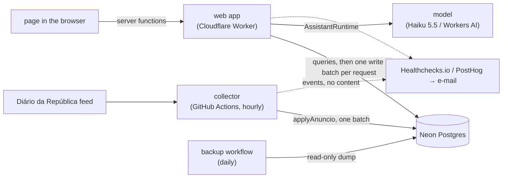

# Technical design: Now discovery (PRD #104)

- PRD: [#104 Now — descobrir e consultar concursos do Diário da República](https://github.com/prumod/cairn/issues/104), as amended by [#191](https://github.com/prumod/cairn/issues/191).
- Stories in scope: 1–49, including the comment threads of stories 30, 30c and 30e, which the PRD gained on 2026-11-09, just before this design merged («Comment threads (fios)» below). «Enviar ao assistente» (stories 30a, 30b, 30d and its parts of 30c, 30e, 32 and rule 19) moved to Later L38 (user, 2026-11-09); «Later: «Enviar ao assistente» (L38)» keeps Now ready for it. «Resolver» (✓) of story 30e moved to Later L39 (user, 2026-11-09, Q3). Domain rules 1–19, «Dados».
- Audit: [#193 audit, 2026-11-09](#audit-2026-11-09) lists what the audit fixed, decided and left open.
- Research: the design session's local notes (`.rpi/prd-104-now-discovery/research.md`, not committed); each decision links the ticket that holds its evidence.
- Visual source: `apps/web/references/initial-visual/index.html` (was `final-visual/`) gives the starting look; production changes it where the PRD or the design needs it ([#226](https://github.com/prumod/cairn/issues/226#issuecomment-6726532466)); the PRD gives behaviour and terms ([#149](https://github.com/prumod/cairn/issues/149)).

## Overview

Cairn Now is two programs and one database.

- The **collector** (`apps/collector`) runs every hour in GitHub Actions. It reads the Diário da República feed, turns each new anúncio into a concurso with its lotes, and saves it.
- The **web app** (`apps/web`) runs on a Cloudflare Worker. The person's page asks it for the listing and sends it the person's actions. The assistant runs inside the same server and uses the same actions as the person.
- Both use one **Neon Postgres** database per environment. The collector writes the public collected data. The web app writes only company data and each person's private data.



Every server action in the web app takes the same path: page → server function (`.functions.ts`) → use case → domain classes and repositories → database. A view action (a filter, the sort, a selection) changes only what the page shows, so the page runs it in the browser through a `DiscoveryView` method, and the assistant runs the same method on the server through `ChangeViewUseCase`. Either way a rule lives once, in a domain class, so the person and the assistant cannot get different answers.

### Words this design uses

| Word                 | Meaning here                                                                                                                                                                                                                                                                                                                               |
| -------------------- | ------------------------------------------------------------------------------------------------------------------------------------------------------------------------------------------------------------------------------------------------------------------------------------------------------------------------------------------ |
| Use case             | One thing a person or the assistant can do, such as `SetLoteCategoriaUseCase`. A class with one method, `execute(context, input)`; the context holds the company, the actor, the time and, for a view action, the view. The 13 view actions are one use case, `ChangeViewUseCase`, because they are one thing: change what the page shows. |
| Entity               | A thing with an id that changes over time, such as `Concurso`. It changes only through its own methods.                                                                                                                                                                                                                                    |
| Value object         | A value that never changes, compared by its content, such as `Radius` or `DiscoveryView`. A change makes a new value.                                                                                                                                                                                                                      |
| Filter               | A class with one question, `admits(lote)`: does this lote pass?                                                                                                                                                                                                                                                                            |
| Repository           | Reads and saves one kind of thing. Each has two versions: Drizzle (the real database) and in-memory (tests and the evaluation).                                                                                                                                                                                                            |
| Seam, adapter        | A seam is a place where the code can use one of two versions of something (real or fake); each version is an adapter. Seams exist only where two versions exist.                                                                                                                                                                           |
| Composition file     | The one file per app that builds every object with `new` and picks the real or the fake adapters for the environment.                                                                                                                                                                                                                      |
| Server function      | A `.functions.ts` file. The page calls it like a function; it runs on the server.                                                                                                                                                                                                                                                          |
| `WriteBatch`         | Collects all the writes of one request and saves them together, or none of them.                                                                                                                                                                                                                                                           |
| `Step`, `DataChange` | `Step`: the record of one action and what came of it. `DataChange`: one changed field with its old and new value.                                                                                                                                                                                                                          |
| Subrequest           | One call from the Worker to something outside it (database, model, PostHog). Workers Free allows 50 per request and 10 ms of CPU.                                                                                                                                                                                                          |
| hvut, hve2e          | High-value unit test (calls a module's entry point, real collaborators, in-memory adapters) and high-value end-to-end test (through the server function and the real database). See [TESTING.md](../../TESTING.md).                                                                                                                        |
| Chain head           | The current anúncio of a concurso: the one that no other anúncio alters.                                                                                                                                                                                                                                                                   |
| IdIncm               | The Diário da República's own id for one anúncio.                                                                                                                                                                                                                                                                                          |
| Turn block           | The facts Cairn adds to each request for the model: date, company, what the page shows, the listing summary.                                                                                                                                                                                                                               |
| Expand-then-contract | Add the new column or table in one release; remove the old one in a later release, once nothing uses it.                                                                                                                                                                                                                                   |
| Typical test         | A fast test of one technical detail, such as parsing or rounding.                                                                                                                                                                                                                                                                          |
| Presenter            | A plain function (not a class) that writes the Portuguese text for a result, such as a step or the listing summary. File: `<name>.presenter.ts`, next to what it formats.                                                                                                                                                                  |
| ⚠ lote               | A lote marked ⚠ with a reason, for a case Cairn does not handle: missing data, a changed lote count, or an unknown location (PRD rules 11, 14).                                                                                                                                                                                            |

## Inherited decisions

Settled in decision tickets; this design builds on them and does not reopen them.

- Collector: hourly GitHub Actions workflow at minute 25 UTC, Bun/Node, writes to Neon over HTTP; conditional GET on the Parte L RSS; unpdf; IdIncm identity; non-empreitada IdIncm remembered; source port with two operations (list today's items, read one anúncio); `collection_failed` structured event; app stays on Workers Free ([#154](https://github.com/prumod/cairn/issues/154), [#150](https://github.com/prumod/cairn/issues/150), [#142](https://github.com/prumod/cairn/issues/142)).
- Assistant: LLM agent with tools covering every page action, ≤10 tool calls, steps built from executed calls; Workers AI first behind one small model port (replaced by `AssistantRuntime`, [#198](https://github.com/prumod/cairn/issues/198#issuecomment-6722916477)); tools and stored conversations in Cairn's own format; provider and model in configuration ([#172](https://github.com/prumod/cairn/issues/172)). Workers AI now serves only the testing environment; production pays per use for the Claude API ([#217](https://github.com/prumod/cairn/issues/217#issuecomment-6723730178)).
- Evaluation: 30–50 Portuguese reference requests on fixed fictional data, mechanical checks, on demand and before a model change ([#172](https://github.com/prumod/cairn/issues/172)); how it runs: «Assistant evaluation» below ([#234](https://github.com/prumod/cairn/issues/234#issuecomment-6726904291)).
- Tests: tags `@frontend` (Playwright, fake backend), `@backend` (Vitest hvut/hve2e), `@system`; the server applies filters and sort; a compatibility check against fake and real backend; controlled Lisbon clock ([#153](https://github.com/prumod/cairn/issues/153)).
- Company: one seeded company, everything company-dependent scoped by company, distance computed at read time ([ADR 0002](../adr/0002-one-company-now-scoped-by-company.md), [#145](https://github.com/prumod/cairn/issues/145)).
- Places: CAOP2025, one representative point per município and freguesia, CC BY 4.0 attributed to DGT ([#151](https://github.com/prumod/cairn/issues/151), [#146](https://github.com/prumod/cairn/issues/146), [#162](https://github.com/prumod/cairn/issues/162)).
- Categoria: fixed 70-row CPV prefix table, longest prefix wins, provisional ([#147](https://github.com/prumod/cairn/issues/147), [#170](https://github.com/prumod/cairn/issues/170)).
- Retention: never store PDFs; keep the latest anúncio's text without section 28 ([#182](https://github.com/prumod/cairn/issues/182)).

## System design

### Packages and apps

Principle (user, 2026-11-07; recorded in [`project-structure.md`](project-structure.md#apps-packages-and-infra), with the corrected meaning of infra below):

> **App**: a unit of deployment. Code deployed to a different environment (for example, the Cloudflare Worker vs. a GitHub Actions job) goes in its own app. One app may hold several runtimes when its framework compiles them together (TanStack Start: browser + Worker).
> **Package**: a unit of packaging. A package's runtime, dependencies and compile settings must be compatible with every destination that uses it: each app and each runtime inside that app. Code whose destinations differ, and so needs different packaging, goes in its own package.

**Infra** is code that talks to something outside our apps (a database, the browser, the DR feed, a model provider), not "server-only database repositories"; the frontend can have infra.

| Package           | Destinations                             | Packaging                                                              |
| ----------------- | ---------------------------------------- | ---------------------------------------------------------------------- |
| `packages/shared` | web browser, web Worker, collector (Bun) | plain TS: no JSX, no DOM, no Node/Worker APIs, no runtime dependencies |
| `packages/db`     | web Worker, collector (Bun)              | server TS: Drizzle, Neon HTTP driver                                   |

```text
packages/shared/src/
  places/              CAOP catalogue: distrito, concelho, freguesia, codes, names, points
  categorias/          annex I categorias and subcategorias
packages/db/src/schema/
  auth.ts              (existing)
  concursos.ts         concurso, anúncio, lote (collector writes; web reads)
  recolha.ts           recolha per publication date and recolha_item (collector writes; web reads states and unread links)
apps/collector/src/
  modules/recolha/
    useCases/collectAnuncios/
    domain/            parseAnuncio, alteração linking, place-name matching, CPV→categoria table
    infra/             DR RSS/PDF source adapter, feed_cursor and cpv_table_state tables
apps/web/src/
  server/modules/company/          company domain, repository, seed, tables (persistence/)
  pages/
    discovery/  assistant/         Now features; their own tables in infra/
    company/                       company profile page (slice 0a)
    backoffice/                    (existing)
  shared/actions/  shared/theme/   isomorphic action catalogue; theme
```

- `packages/shared` replaces the reserved root `shared/src` (which does not exist); move its boundary rules to the new path.
- `drizzle.config.ts` schema globs add `src/schema/*.ts`, `apps/collector/src/modules/*/infra/*Table.ts` and `apps/web/src/pages/*/infra/*Table.ts` (the discovery feature owns `lote_categoria_manual`; the assistant feature owns the context, thread and conversation tables). The existing `apps/web/src/server/modules/*/persistence/*Table.ts` glob keeps the company tables.
- The existing `client-cannot-import-server` rule already keeps `packages/db` out of browser code; no new rule.

### Design direction

Settled in [#203](https://github.com/prumod/cairn/issues/203) (user, 2026-11-07). The PRD is mostly read-side rules (18 stories, 6 rules), then the assistant (12 stories), browser interaction (8), user writes (7) and collection (2 stories, but rule 11 is the densest). Trust is the dominant quality attribute; Workers Free limits are the binding constraint.

Written here in the code's own words («Code conventions» below); #203 used the DDD names that the conventions later replaced.

1. **Reading comes first.** Most of the PRD is rules about which lotes to show. The listing is one repository method that returns rows, then a set of `Filter` classes over them. Only two things own other things and protect rules about them: `Concurso` owns its anúncios and lotes (collection), and a conversation owns its messages. Company is a plain entity.
2. **One action catalogue** shared by the person and the assistant.
3. **Work out during collection what does not change.** A request is one narrow query plus plain functions and filters.
4. **Each module decides for itself.** Only two places coordinate several modules: the assistant loop (the private `AssistantLoop` class, which the send and confirm use cases call) and the concurso merge (`Concurso.applyAnuncio`). No events, event bus or subscribers.
5. **Frontend:** the selection gestures are a frontend class (`SelectionGestures`: click, Shift-click and Ctrl-click → a new `DiscoverySelection`); plain functions turn the current state into what a component shows; the state lives in the URL (TanStack Router search params) and the TanStack Query cache; no MobX.

Growth guardrails (user, 2026-11-07). Later and Maybe (proposal, contract, execution, post-obra) are a much richer domain; do not build for them, but keep these cheap seams:

1. Stable identities for concurso and lote, which later contexts will reference.
2. Company scoping everywhere (ADR 0002).
3. Modules by context, not by technical layer, so a Proposal context can arrive with its own entities.
4. The action catalogue as the one entry point, so new modules add actions and the assistant gets them.
5. Keep the assistant's data-change record (field, old value, new value), the basis for Later L32's undo.

Revisit "no events" when a second context reacts to discovery (for example, «Participar» opens a dossier).

### Code conventions for the team (user, 2026-11-08)

Three junior developers join the team, so the code uses plain object-oriented forms and only the DDD names a beginner understands ([#215](https://github.com/prumod/cairn/issues/215); `CODING_STANDARDS.md` «Classes, pattern names and file names»). This design uses the same names.

- **Class or function.** A class when several functions belong together, or when at least one value and one function that uses it belong together. Data with no behaviour is a TypeScript `type`; it becomes a class when a function joins it. Anything else is a plain function.
- **Names in use:** Entity, Value Object, Repository, Use Case (one action; the repo's existing `useCases/` term), Service (a rule that spans several entities), Filter, Source/Client (adapters to the outside).
- **Names not used:** Aggregate (say «`Concurso` owns its lotes»: outside code changes a lote only through a `Concurso` method), Policy/Specification/Criterion (a `Filter` or an entity method), Read Model/Query object (a repository method that returns rows for a screen), Bounded Context, Anti-Corruption Layer, Domain Event.
- **The pattern is visible twice:** in the class declaration and in the file name. File names are lowerCamel like the existing code.

| Pattern         | Declaration                                                                                                                                                       | File                                                                                     |
| --------------- | ----------------------------------------------------------------------------------------------------------------------------------------------------------------- | ---------------------------------------------------------------------------------------- |
| Entity          | `class Concurso extends Entity`                                                                                                                                   | `concurso.entity.ts`                                                                     |
| Value Object    | `class Radius extends ValueObject`                                                                                                                                | `radius.valueObject.ts`                                                                  |
| Repository      | `interface ConcursoRepository`; `class DrizzleConcursoRepository implements ConcursoRepository`; `class InMemoryConcursoRepository implements ConcursoRepository` | `concurso.repository.ts`; `concurso.repository.server.ts`; `concurso.repository.fake.ts` |
| Use Case        | `class SetLoteCategoriaUseCase`                                                                                                                                   | `setLoteCategoria.useCase.ts`                                                            |
| Service         | `class CategoriaRecomputeService`                                                                                                                                 | `categoriaRecompute.service.ts`                                                          |
| Filter          | `class DistanceFilter implements LoteFilter`                                                                                                                      | `distance.filter.ts`                                                                     |
| Source / Client | `class DrAnuncioSource implements AnuncioSource`                                                                                                                  | `drAnuncio.source.ts`                                                                    |

- **An adapter's file name** is `<what it is about>.<seam>.<where it runs>.ts`. The suffix is always the seam: `.repository`, `.runtime`, `.clock`, `.writeBatch`, `.source`. The first word differs: a repository adapter names the thing it stores (`concurso.repository.server.ts`, `concurso.repository.fake.ts`), because each repository stores one thing; an adapter at any other seam names its technology (`aiSdk.runtime.server.ts` and `scripted.runtime.fake.ts` for `AssistantRuntime`, `system.clock.ts` and `fixed.clock.fake.ts` for `Clock`, `neon.writeBatch.server.ts` and `inMemory.writeBatch.fake.ts` for `WriteBatch`), because the seam has one job and the adapters differ only in what they use.
- **`extends` only where the base shares real behaviour:** `Entity` (id, `equals` by id) and `ValueObject` (`equals` by content, frozen after creation). Repositories, filters and adapters use `implements` an interface, so a repository never inherits a `delete` that the Concurso rules forbid. Use cases and services have no base class; the suffix names them.

**Where each file goes** (inside one feature or module; audit, 2026-11-09, fitted to the folder roles of [`project-structure.md`](project-structure.md#required-feature-driven-structure) and its dependency rules):

| File                                                                                   | Folder                                                                                                                                                              | Example                                                                                                          |
| -------------------------------------------------------------------------------------- | ------------------------------------------------------------------------------------------------------------------------------------------------------------------- | ---------------------------------------------------------------------------------------------------------------- |
| Public entry point for other modules' use cases (framework-free)                       | module root                                                                                                                                                         | `pages/discovery/discovery.ts`                                                                                   |
| Public entry point for other features' pages (server function)                         | module root                                                                                                                                                         | `pages/assistant/marks.functions.ts`                                                                             |
| Entity, value object, filter, service                                                  | `domain/`                                                                                                                                                           | `domain/discoveryView.valueObject.ts`                                                                            |
| Repository `interface`                                                                 | the folder of the use case that uses it; `domain/` when several do                                                                                                  | `domain/lote.repository.ts`                                                                                      |
| Use case and its server function                                                       | `useCases/<name>/`                                                                                                                                                  | `useCases/setLoteCategoria/setLoteCategoria.useCase.ts` + `.functions.ts`                                        |
| Plain class or function with no pattern name, used by several use cases of the feature | `useCases/` root, named after it                                                                                                                                    | `useCases/assistantLoop.ts`, `useCases/guardedTools.ts`, `useCases/modelInput.ts`                                |
| Interface at any other seam                                                            | as a repository `interface`; a seam that several modules use goes in `apps/web/src/server/shared/<seam>/` or `apps/collector/src/shared/<seam>/`, with its adapters | `domain/lote.filter.ts` (`LoteFilter`), `server/shared/writeBatch/writeBatch.ts`, `server/shared/clock/clock.ts` |
| Presenter                                                                              | next to what it formats                                                                                                                                             | `useCases/changeView/listingSummary.presenter.ts`                                                                |
| Browser-only class used by components                                                  | `components/<name>/`                                                                                                                                                | `components/selection/selectionGestures.ts`                                                                      |
| `Entity` and `ValueObject` base classes                                                | `packages/shared/src/model/` (the collector, the web server and the browser all use them)                                                                           | `packages/shared/src/model/entity.ts`                                                                            |
| Drizzle repository, table, outside source or client                                    | `infra/`                                                                                                                                                            | `infra/lote.repository.server.ts`, `infra/loteCategoriaManualTable.ts`                                           |
| In-memory repository, fake clock or source                                             | `infra/`, next to the real                                                                                                                                          | `infra/lote.repository.fake.ts`                                                                                  |
| Component                                                                              | `components/`                                                                                                                                                       | `components/placesMap/placesMap.tsx`                                                                             |

A test sits next to the file it tests. A repository `interface` follows `project-structure.md`'s rule for `domain/`: it moves there only when a second use case needs it. The existing backoffice files (`useCases/changeAccess/changeAccess.ts`) predate the `.useCase.ts` suffix; they keep their names until someone next changes them.

Code properties, settled in [#206](https://github.com/prumod/cairn/issues/206) (user, 2026-11-08), in the `codebase-design` vocabulary:

1. **Deep modules, as the general rule.** A module has one small entry point with the behaviour behind it. Example: `ListLotesUseCase.execute(context, search)` (the company and the time come in `context`) applies the filters, distance, estado, sort and grouping; `DistanceFilter` and the other small classes are not exported. Two exceptions: `RadiusFilter`, the one radius rule, which the actions of #204 reuse ([#195](https://github.com/prumod/cairn/issues/195)), and `GetLotesUseCase`, which tells another module whether each of a list of lotes is inside the radius. The person and the assistant get the same list by construction (story 38).
2. **A seam only where two adapters exist.** An `interface` with swappable adapters exists only where two adapters really exist: Drizzle + in-memory repository, real + fake clock, AI SDK + scripted `AssistantRuntime`, DR + fixture anúncio source (the full list is «Seams» below). Otherwise, the code uses the class directly; extract the interface when the second adapter arrives.
3. **Constructor injection, wired by hand.** A class receives its dependencies through its constructor. One composition file per app (`web`, `collector`) builds the objects with plain `new`; no DI container, and no module-level imports of adapters. Only the composition file branches on environment or configuration: it takes a Zod-parsed, typed `env` (a choice with several values is a union handled by an exhaustive `switch`) and picks the adapters. Classes never read `process.env` or bindings. The web app composes inside the request handler with that request's `env`; the collector composes once at start. Tests call constructors with fakes, or call the composition function with a test `env`.
4. **Who changes what.** An entity changes through its own methods (`concurso.applyAnuncio(parsed)`), and the repository saves it. A value object never changes. View state and the selection return a new value on each change (`gestures.toggle(selection, loteId)` returns a new `DiscoverySelection`), as React and the router search params need.
5. **What tests reach.** High-value tests reach only a module's interface (its entry point and the adapters at its seams), with real collaborators and no mocks; internal classes are covered through the entry point. Typical tests ([TESTING.md](../../TESTING.md)) may import a private file of their own module, colocated with it, only to check a technical detail faster or more precisely (anúncio parsing, place derivation, distance arithmetic, Lisbon date boundaries, CPV mapping). The existing boundary check already allows this and keeps other modules out. Rule of thumb: what the person or the assistant would notice is high-value and goes through the interface.

## Program design

### Module map, seams, tests and slices

Settled in [#235](https://github.com/prumod/cairn/issues/235#issuecomment-6726996956) (2026-11-08; the slice order was left to the agent by the user). Full per-module detail in the resolution; the sections below keep each module's behaviour.

- **Use case:** a class, constructor dependencies, one `execute(context, input)`, the same shape for every action; `ActionContext = { company, actor, now }`, and a view action's context adds `view` and it returns `{ view, step }`. The input is exactly the action's Zod input, so the tool the model sees and the use case take the same thing.
- **View actions: one use case.** The page applies view actions by calling the `DiscoveryView` methods directly. On the server, one class runs all 13: `ChangeViewUseCase` (`useCases/changeView/changeView.useCase.ts`), `execute(context, action) → { view, step }`, where `action` is `{ name, input }` for one of the 13 view actions (a TypeScript union). Its body is one exhaustive `switch` on the name, like a React reducer: each case calls the `DiscoveryView` method and does that action's own check (radius through `GetConcursoUseCase`, listed ids, comparison size through `LoteComparison`). After the `switch`, the common end runs once: only when the new view's search (filters and sort) differs from `context.view`'s does it run `ListLotesUseCase`, prune the selection and add the listing summary to the `Step`, so `closeConcurso`, `openScreen` or `clearSelection` never run the listing. Each view entry in `ActionCatalogue` keeps its own name, Zod input and presenter, and calls `changeView.execute(context, { name, input })`; the tool still takes exactly that action's input. Rejected: 13 classes of a few lines each with a shared `finishViewAction` helper (A25). The view's context type is `ViewActionContext = ActionContext & { view: DiscoveryView }`, exported by `pages/discovery/discovery.ts`: `ActionContext` lives in the isomorphic `shared/actions`, which may not import a page. Company, actor and now stay the same for a whole request; the view does not: `GuardedTools` gives each view call the view the previous call returned. The page calls the server to read (`listLotes`, `getConcurso`, `compareLotes`, which apply `RadiusFilter`) and for each context and data action, one `.functions.ts` each.
- **One write per request:** Drizzle repositories queue on the request's `WriteBatch` (Neon / in-memory adapters); one `commit()` = one `db.batch`; reads do not see queued writes.
- **Imports:** a use case or domain file may import another module's public, framework-free root file (`discovery.ts`, `company.ts`) and the isomorphic `apps/web/src/shared/actions/` (`ActionCatalogue`, `Step`, `DataChange`, `RefusalReason`, `ActionContext`); never another module's infra. Inside a feature, a use case may import the `useCases/` root helpers and receive another use case of its feature through its constructor (`ChangeViewUseCase` receives `ListLotesUseCase` and `GetConcursoUseCase`). The import of another use case is `import type` only, so the composition file stays the one place that builds objects. The current dependency rules allow neither yet; the exact rule change is in [`project-structure.md`](project-structure.md#apps-packages-and-infra) («Imports between modules»), made by the first slice that needs it. Composition: `apps/web/src/server/composition.server.ts` (per request, absorbs `getRuntime`), `apps/collector/src/composition.ts`.
- **Two shapes of the same data:** the web app reads plain `CandidateLote` / `ConcursoDetail` types from `LoteRepository` and never changes them; the `Concurso` entity (owning `Anuncio`, `Lote`), which changes, lives only in the collector.

| Module              | Place                                                                                                                                              | Interface                                                                                                                                                                                                                                                                                                                                    | Calls                                                                             |
| ------------------- | -------------------------------------------------------------------------------------------------------------------------------------------------- | -------------------------------------------------------------------------------------------------------------------------------------------------------------------------------------------------------------------------------------------------------------------------------------------------------------------------------------------- | --------------------------------------------------------------------------------- |
| Recolha             | `apps/collector/src/modules/recolha/`                                                                                                              | `CollectAnunciosUseCase.execute()`, which first runs the private `CategoriaRecomputeService` when the CPV table's hash changed; `main.ts` checks `schemaBehind`                                                                                                                                                                              | `packages/shared`, `packages/db`                                                  |
| Places, categorias  | `packages/shared`                                                                                                                                  | `PlaceCatalogue`, annex I, CPV table                                                                                                                                                                                                                                                                                                         | —                                                                                 |
| Company             | `server/modules/company/` (`company.ts` domain, `company.server.ts` repository + seed); page and `UpdateCompanyProfileUseCase` in `pages/company/` | `Company` entity, `Radius`, `CompanyLocation`, `Alvara`                                                                                                                                                                                                                                                                                      | actions                                                                           |
| Actions             | `src/shared/actions/` (isomorphic)                                                                                                                 | `ActionCatalogue` built in the composition from `discoveryActions`, `companyActions`, `contextActions`                                                                                                                                                                                                                                       | —                                                                                 |
| Discovery view      | `pages/discovery/domain/`; `SelectionGestures` in `pages/discovery/components/selection/`                                                          | `DiscoveryView`, `LoteComparison`, `ViewActionContext`; frontend `SelectionGestures`                                                                                                                                                                                                                                                         | —                                                                                 |
| Lote listing        | `pages/discovery/`                                                                                                                                 | `ListLotesUseCase.execute(context, search) → LoteList` (with the range's recolha states), `RadiusFilter`, `GetConcursoUseCase` and `GetLotesUseCase` (exported through `discovery.ts`); `ChangeViewUseCase` (the 13 view actions); `SetLoteCategoriaUseCase`; `listLotes`, `getConcurso`, `compareLotes`, `setLoteCategoria` `.functions.ts` | company, places                                                                   |
| Places map          | `pages/discovery/components/placesMap/`                                                                                                            | component over `LoteList`; private `projectFromCompany`                                                                                                                                                                                                                                                                                      | —                                                                                 |
| Look and theme      | `src/style.css`, `src/shared/theme/`                                                                                                               | plain functions, no seam                                                                                                                                                                                                                                                                                                                     | —                                                                                 |
| Comments, citations | `pages/assistant/`                                                                                                                                 | `CommentUseCase`, `CiteUseCase` (catalogue); edit, delete, clear, delete thread (person); `marks.functions.ts` at the root, passed to discovery as props by the Now layout                                                                                                                                                                   | discovery (`GetConcursoUseCase`, `GetLotesUseCase`; `RadiusFilter` for place ids) |
| Assistant loop      | `pages/assistant/`                                                                                                                                 | `SendMessageUseCase`, `ConfirmChangesUseCase`, `RevertUseCase`, `NewConversationUseCase`, `SetAssistantModeUseCase`; private `AssistantLoop`; `GuardedTools` (`definitions()`, `call(name, input)`), exported through `assistant.ts`                                                                                                         | actions, discovery, company                                                       |
| Model input         | `pages/assistant/useCases/modelInput.ts`, exported through `assistant.ts` for the evaluation                                                       | `class ModelInput`: `build(conversation, turn) → { messages, tokens }` in Cairn's format, and `fingerprint(view, company)`; its parts (instructions, turn block, sent items, token estimate chars ÷ 3 up) are private                                                                                                                        | — (pure; the send use case passes in what `GetLotesUseCase` returned)             |
| Evaluation          | `apps/web/evals/assistant/`                                                                                                                        | as #234; uses `GuardedTools` and `ModelInput.fingerprint(view, company)` from the assistant's root file                                                                                                                                                                                                                                      | web composition                                                                   |

- **Seams (two adapters, no others):** `AnuncioSource` (DR / fixture); Drizzle / in-memory `ConcursoRepository`, `RecolhaRepository`, `LoteRepository`, `LoteCategoriaRepository`, `CompanyRepository`, `ContextItemRepository`, `CommentThreadRepository`, `ConversationRepository`, `AssistantPreferenceRepository` (mapped to #233's tables); `WriteBatch`; `Clock`; `AssistantRuntime`. Each pair runs one shared contract test on the disposable Postgres.
- **Tests:** doubles only from that list plus controlled HTTP servers (DR feed, Anthropic-compatible model server); no fake use case, `listLotes` or `RadiusFilter`. High-value at each interface above; `@backend` hve2e through each `.functions.ts`; assistant hve2e through `AiSdkAssistantRuntime` against the controlled server; collector `@system` test (controlled DR → database → `listLotes`); typical tests on parsing (committed real public DR anúncios), place derivation, CPV, `Distance`, Lisbon dates, projection, transitions, token estimate, cached prefix; scheduled live smoke tests for the DR feed and each provider.
- **Slices (agent, user did not know):** 0a company + `style.css`/theme → 0b **walking skeleton with real collection** (feed → `applyAnuncio` → `listLotes` with `RadiusFilter` → table, testing and production; ships with the daily backup of [#238](https://github.com/prumod/cairn/issues/238#issuecomment-6727073069)) → 1 filters, estado, sort, URL state, recolha messages → 2 consulta, comparison → 3 places → 4 selection, comments, citations, manual categoria → 5 assistant (scripted first) → 6 evaluation → 7 complete recolha. From 0b every empreitada item not fully merged is a `recolha_item` `porLer` with its link; slice 7 replays every `porLer` item.

### Concurso and its lotes (collection)

Settled in [#205](https://github.com/prumod/cairn/issues/205).

- **Boundary:** concurso (root) + anúncios + lotes. Only the collector changes it: `collectAnuncios` loads it through `ConcursoRepository` by any known IdIncm (its own, or the altered anúncio's IdIncm from the alteração header), calls `Concurso.applyAnuncio(parsed)` and saves it in one `db.batch` (neon-http, atomic). There is no version check: collector runs never overlap (#154), and the web writes only its own company-scoped table.
- **Identities (growth guardrail 1):** the concurso has a surrogate uuid, generated by the code when the concurso is created («Data model», Conventions), not an IdIncm (the anúncio that creates it may be an alteração). The lote has a surrogate id that never changes, with a unique (concurso id, lote number) key; the lote number is the `k` of the printed «Identificador do Lote: LOT-000k»; the merge matches by that number, never by list position, description or «Número de referência interna», and never re-keys or reuses a lote id. A lote is one lote for the life of its concurso: a matched lote takes all its data from the current anúncio, place included, and keeps its id and references; earlier per-anúncio values are not kept (reachable through the DR link). A concurso without lotes has one implicit lote numbered 1, so a later `LOT-0001` matches it. Base: [#205](https://github.com/prumod/cairn/issues/205#issuecomment-6723174112), settled with the eForms guidance (the same lot keeps its identifier for the whole procedure) and #212's 0 renumberings in 109 pairs; ADR 0003. The anúncio is identified by (fonte, identificação): DR + IdIncm today.
- **Outside:** manual categoria, comments, citations, selection, conversation steps and later contexts. They refer to the lote id.
- **Invariants:** idempotent per IdIncm. The current anúncio is the chain head (the anúncio no other one alters), not the latest arrival; a late original adds its provenance and link and replaces nothing. Data come from the current anúncio; the publication date is the earliest known, header-only entries included. An unknown altered anúncio becomes an entry with IdIncm, number and date, without a link. Lotes match by number; a new number adds a lote, a missing number keeps its lote, and a count change sets ⚠ «Lotes alterados no anúncio». «Alterado» is set when there is more than one anúncio; ⚠ «intenção de cancelamento» stays. The repository has no delete.
- **Categoria:** the lote stores `cpv` and `categoriaCpv` (collector and recompute only). A manual categoria is company-dependent, so under ADR 0002 it is not stored on the lote: **lote categoria manual** (company id, lote id, categoria), unique on (company id, lote id), is written only by the «definir categoria» action of the catalogue, which the person and the assistant share. The categoria shown is the company's manual one, else `categoriaCpv`; its origin is «manual» when the record exists. The assistant's data-change record keeps the lote id, the field, the old value with its origin, and the new value.
- **Manual categoria is one company's choice** (user, [#207](https://github.com/prumod/cairn/issues/207)): one company's record never changes another's list, filters or comparison; no shared correction (it can be added later as a layer underneath). The record also stores `set_by` (the person, or the assistant on the person's behalf) and `set_at`. `setLoteCategoria` with `categoria: null` deletes the record, so the lote falls back to `categoriaCpv` with origin «CPV». This is «Repor categoria do CPV» (user, [#216](https://github.com/prumod/cairn/issues/216#issuecomment-6723735750)): the page offers it where the categoria is edited, only when the origin is «manual», with no confirmation; the assistant uses it under the mode; a reset with no record is `refused` `nothingToChange`; setting a manual categoria equal to the CPV one still records it as manual. The table belongs to the `apps/web` discovery module (FK to the lote in `packages/db`). `listLotes` left-joins the request company's records on the unique key and computes the effective categoria before the categoria filter and «Por classificar»; consulta and comparison show the same value. The record keys on the lote id, which no alteração changes ([#205](https://github.com/prumod/cairn/issues/205#issuecomment-6723174112)).
- [ADR 0002](../adr/0002-one-company-now-scoped-by-company.md) names the CPV categoria among the public lote data and «the manual categoria of a lote» in the company-scoped list (amended).
- **Stored at collection:** concurso publication date, deadline (Lisbon), «Alterado», concurso ⚠ reasons (lotes alterados, intenção de cancelamento, prazo não indicado), anúncio provenance; lote place codes, point (freguesia or concelho with «≈»), place leaf (freguesia / «Todo o concelho» / «Freguesia por identificar» / «Todo o distrito» for «Concelho: Todos» / «Todo o país» for «Distrito: Todos» / none for ⚠, [#196](https://github.com/prumod/cairn/issues/196)), lote ⚠ reasons, `cpv`, `categoriaCpv`, valor, prazo de execução.
- **Per request:** only distance (company's current location → lote point) and estado (deadline vs. Lisbon clock), as plain functions.
- **Recompute:** the collector stores the CPV table's content hash. When the hash changes, the next run first recomputes `categoriaCpv` from `cpv` for every lote, inside the same concurrency group, and never touches the manual-categoria table. CAOP updates are not covered (the PRD fixes CAOP2025).

### Action catalogue

Settled in [#204](https://github.com/prumod/cairn/issues/204) (user, 2026-11-08: only the radius limits what the assistant opens, compares, comments on or cites).

- **One entry point (growth guardrail 4).** Each action is a Use Case (`class SetLoteCategoriaUseCase` in `setLoteCategoria.useCase.ts`; the 13 view actions share `ChangeViewUseCase`) in its owning feature (`pages/discovery`, `pages/company`, `pages/assistant`), with a Zod input. `class ActionCatalogue`, built in the composition root (`apps/web/src/server/`), registers each one with its name, kind, input and step presenter. The page calls it through its server function or presenter; the assistant's `GuardedTools` gives one tool per entry. The loop treats an action only by its kind.
- **Kinds:** **view** (always applies), **context** (comment, cite: every mode, into the context to send), **data** (profile, lote categoria: by the mode; «Confirmar» asks, «Desligado» refuses with `dataChangesOff`).

| Action                             | Kind                 | Input                                                                                                                                                                    | Effect                                                                                 |
| ---------------------------------- | -------------------- | ------------------------------------------------------------------------------------------------------------------------------------------------------------------------ | -------------------------------------------------------------------------------------- |
| `setFilters`                       | view                 | patch: `distanceKm`, `publicationDate {from?, to?}`, `deadline {from?, to?}`, `estado[]`, `valor {min?, max?}`, `entidadeIds[]`, `categorias[]` (id or `porClassificar`) | applied filters; listing summary                                                       |
| `clearFilters`                     | view                 | —                                                                                                                                                                        | listing summary (estado «Aberto», sort kept)                                           |
| `filterByPlaces`                   | view                 | `placeIds[]` (`[]` removes)                                                                                                                                              | place filter (replaces); listing summary                                               |
| `setSort`                          | view                 | `publicationDate` / `deadline`                                                                                                                                           | listing summary                                                                        |
| `selectLotes`                      | view                 | `loteIds[]`, `mode` replace/add/remove                                                                                                                                   | selected ids; unlisted ids refused (rule 2)                                            |
| `selectPlaces`                     | view                 | `placeIds[]`, `mode`                                                                                                                                                     | selected places, named by highest level                                                |
| `clearSelection`                   | view                 | `lotes` / `places`                                                                                                                                                       | empty selection                                                                        |
| `openConcurso` / `closeConcurso`   | view                 | `concursoId` / —                                                                                                                                                         | consulta summary, `listed`                                                             |
| `compareLotes` / `closeComparison` | view                 | `loteIds[]` / —                                                                                                                                                          | comparison rows                                                                        |
| `openScreen`                       | view                 | `screen`: a Zod enum of the Now routes (fixed in slice 0a)                                                                                                               | screen opened                                                                          |
| `findConcurso`                     | view, assistant only | `name`                                                                                                                                                                   | candidates in radius (id, title, distance, `listed`); outside: title, distance, radius |
| `comment`                          | context              | `threadId`, or `loteIds[]` or `placeIds[]` to open a thread; `text`                                                                                                      | comment id, thread id, author                                                          |
| `cite`                             | context              | `concursoId`, `field`, `excerpt`, `note`; `loteId` for a lote field, `anuncioId` for an anúncio field                                                                    | citation id, author, source                                                            |
| `updateCompanyProfile`             | data                 | patch: `name`, `morada`, `alvará`, `radiusKm` 1–200                                                                                                                      | `DataChange[]`                                                                         |
| `setLoteCategoria`                 | data                 | `loteId`, `categoria` (annex I id, or `null` = «Repor categoria do CPV», [#216](https://github.com/prumod/cairn/issues/216#issuecomment-6723735750))                     | `DataChange` (origin manual, or manual → CPV on a reset)                               |

- **Listing summary:** lote count and the first 10 concursos with id, title, estado and lote ids (tuning value).
- **Person-only, outside the catalogue:** edit/delete context, clear prepared context, send, Reverter, «Nova conversa», mode, focus, collapse group, Diário da República links.
- **Step** (`type Step`): action, input, outcome (`applied` / `limited` / `refused` + reason / `awaitingConfirmation`), effect, and for data actions the `DataChange` list. Reasons: `outsideRadius`, `notListed`, `comparisonSize`, `dataChangesOff`, `notFound`, `ambiguous` (with candidates), `excerptNotInField`, `nothingToChange` (reset of a lote with no manual categoria, [#216](https://github.com/prumod/cairn/issues/216#issuecomment-6723735750)), `invalidInput`. A presenter writes the Portuguese text; the loop records steps from executed calls.
- **`DataChange` (growth guardrail 5):** `class DataChange extends ValueObject`: entity reference, field, old value, new value. The use case builds it for every actor; the loop stores it in the Conversation for the assistant. Basis for Later L32; Now never undoes with it.
- **Radius guard:** only `RadiusFilter` (#195), on the server, for the listing, `openConcurso`, `compareLotes`, `comment`, `cite`, `findConcurso` and `setLoteCategoria` (refused `outsideRadius` before it reads the old value, so its `DataChange` never shows an outside lote's categoria; A31). `cite` refuses `notFound` when its `loteId` or `anuncioId` does not belong to its `concursoId`. A concurso is inside when one of its lotes is. `distanceKm` above the radius → `limited` at the radius (story 10). The current filters do not limit open/compare/comment/cite; the table is unchanged (rule 5). Selection stays listed-only.
- **Comparison size:** only `class LoteComparison extends ValueObject` (2–4, «Comparar aceita 2 a 4 lotes»), created by `compareLotes` for Enter, the bar and the assistant.
- **Names to ids:** `GuardedTools` maps a place, entidade or categoria name to an id among the options the page shows; no match or several → refused step with candidates.
- **Selection:** the frontend `SelectionGestures` class computes gestures and applies `selectLotes` / `selectPlaces`; the bar acts on the selected ids and then clears the selection. The assistant passes ids directly and keeps the person's selection (rule 4).
- **Context:** every use case gets the company and the actor; no input carries the company (guardrail 2). Inputs use stable ids only (guardrail 1).
- **Where view actions run:** the view state is «Discovery view state» below ([#199](https://github.com/prumod/cairn/issues/199)); the assistant runs them on the server through `ChangeViewUseCase`, inside its loop ([#198](https://github.com/prumod/cairn/issues/198#issuecomment-6722916477)).
- **Collector and radius:** the collector collects every empreitada in the country; the radius applies at every read, so a larger radius shows concursos already collected (story 3, ADR 0002). Rejected by the user (2026-11-08): collecting only within the 200 km maximum radius, because raising the cap later would lose history (no PDFs kept, the feed has only today) and several companies would need the area around every company location.

### Discovery view state

Settled in [#199](https://github.com/prumod/cairn/issues/199) (user, 2026-11-08: what survives a reload; what Back undoes).

- **`class DiscoveryView extends ValueObject`** (`pages/discovery/domain/discoveryView.valueObject.ts`, isomorphic) = `DiscoverySearch` (URL) + `DiscoverySelection` (memory).
  - `DiscoverySearch`: `filters` (`distanceKm?` integer, absent = at the radius; `publicationDate {from?, to?}`; `deadline {from?, to?}`; `estado[]`, default `["aberto"]`; `valor {min?, max?}` as entered; `entidadeIds[]`; `categorias[]` (id or `porClassificar`); `placeIds[]`, the place filter), `sort` (default `publicationDate`), `consultaId | null`, `comparisonLoteIds | null` (2–4 through `LoteComparison`).
  - `DiscoverySelection`: `loteIds[]`, `placeIds[]`.
- **Transitions return a new view:** `withFilters(patch, radius)` (≥ radius → absent, story 10; closes the comparison, rule 7; keeps the consulta, rule 5), `clearFilters()` (sort kept, story 19), `filterByPlaces(ids)` (replaces; empties the place selection), `withSort`, `openConcurso`/`closeConcurso`, `withComparison`/`closeComparison` (opening it closes the consulta), `withLoteSelection`, `withPlaceSelection` (rule 3), `pruneSelection(listedLoteIds)` (rule 2), `historyModeFor(previous)`. `ChangeViewUseCase` calls them: `execute(context, action) → { view, step }`, with the view in `context`.
- **What survives a reload (user):** the search sits in the URL, on the authenticated Now layout route's `validateSearch`, so every Now screen carries it. It uses the default JSON serialization, with `stripSearchParams` for defaults and Zod `.catch(default)` per field. Selections, focus, anchor, collapsed groups and map pan/zoom stay in memory and are lost on a reload. Selections are React state at the Now layout, changed through the frontend `SelectionGestures` class; places have no range.
- **What Back undoes (user):** `push` when the screen, the consulta or the comparison changes; `replace` for filters, sort, «Limpar filtros» and «Filtrar por estes locais». The assistant follows the same rule.
- **Stale ids:** a consulta or comparison outside the radius or unknown on load shows the refusal and drops the field (replace).
- **Pruning:** the browser prunes on each new listing in the query cache; `ChangeViewUseCase` returns a pruned view.
- **Wire:** the assistant request carries the whole `DiscoveryView`; the reply returns the new one, which the browser applies with `historyModeFor`. The assistant works on the view at send time; if the person changed the view meanwhile, the browser keeps it and the reply offers «Mostrar o resultado do assistente» (user, [#198](https://github.com/prumod/cairn/issues/198#issuecomment-6722916477)).
- **Ids:** `PlaceId` is the places catalogue code (CAOP DICOFRE: distrito 2 digits, concelho 4, freguesia 6, so the lengths never collide); the special leaves are the concelho code + `:todo` / `:porIdentificar`, the distrito code + `:todo`, and `pais:todo`. `EntidadeId` is the `entidade_adjudicante` uuid; the entidade is keyed by its NIPC ([What identifies an entidade adjudicante?](https://github.com/prumod/cairn/issues/209)).
- **What each filter value means in `listLotes`** (empty estado, min > max, effective distance): see «Lote listing» below ([#195](https://github.com/prumod/cairn/issues/195)).

### Lote listing

Settled in [#195](https://github.com/prumod/cairn/issues/195) (user, 2026-11-08: place counts ignore the place filter; one empty-table message; a ⚠ lote passes only the filters whose data it lacks; «Intenção de cancelamento» is a third estado).

- **Split:** `ListLotesUseCase.execute(context, search)` (`search` = the filters and the sort of `DiscoverySearch`; the company and `now` come from `context`) runs one SQL query that only narrows, loosely (it may keep extra rows, never drop one), then one pure TypeScript pass decides everything: radius, eight filters, distance, estado, sort, grouping, counts. Each rule lives once, in TypeScript.
- **SQL narrows only by:** a bounding box around the company location on the lote point (1 km margin) plus every lote without a point (`RadiusFilter` decides them, [#196](https://github.com/prumod/cairn/issues/196)); when «Prazo terminado» is off, deadline null, or no more than one day past `now`, or the cancellation flag set; the publication-date range widened by one day. Nothing else.
- **One query, one subrequest:** listing columns only (no anúncio text, no provenance), left-joining the viewing company's lote categoria manual rows ([#207](https://github.com/prumod/cairn/issues/207)). `company` comes from the request context.
- **Repository:** `interface LoteRepository` with `findCandidates(company, narrowing)`; `DrizzleLoteRepository` narrows and caches rows per request by narrowing key (up to 10 assistant tool calls parse them once); `InMemoryLoteRepository` returns every lote.
- **Filters** (private, `implements LoteFilter`, `admits(lote)`): `RadiusFilter`, `DistanceFilter`, `PublicationDateFilter`, `DeadlineFilter`, `EstadoFilter`, `ValorFilter`, `EntidadeFilter`, `CategoriaFilter`, `PlaceFilter`.
  - **Radius vs distance:** two filters. `RadiusFilter` is the company's search radius, exported as the module's second interface item, and it is the one limit for the listing, `openConcurso`, `compareLotes`, `comment`, `cite` and `findConcurso` (#204). The assistant module reaches it through `GetConcursoUseCase` and `GetLotesUseCase`, and directly only to test place ids; it never reads `LoteRepository`. `DistanceFilter` is the person's km filter, capped at the radius. Both use one private `class Distance extends ValueObject`: the great-circle distance by the haversine formula on a sphere of radius 6 371.0088 km (the mean Earth radius), rounded to a whole km, half up (audit, 2026-11-09: the boundary tests at 50.4 / 50.5 km need one fixed formula; the map projection uses the same sphere, so the drawn circle matches the rule).
  - **⚠ exemption (user):** a filter never hides a lote only for missing the data it reads. Distance and place admit a lote without a location; valor admits no valor; deadline admits no deadline; estado admits «Prazo não indicado». «Lotes alterados no anúncio» lotes are filtered normally.
  - **Values:** valor min > max → not applied; empty `estado[]`, `entidadeIds[]`, `categorias[]` or `placeIds[]` → that filter does not apply; absent `distanceKm` → at the radius, and a stored value above the current radius is capped.
- **Estado (user, Q4):** computed per concurso from the deadline (stored instant) and the clock. Priority: «Intenção de cancelamento», then «Prazo não indicado», then «Aberto» / «Prazo terminado» at the deadline minute. The filter offers «Aberto», «Prazo terminado», «Intenção de cancelamento»; default «Aberto» only.
- **Order:** publication date newest first (default) or deadline soonest first, missing last; ties by title, then concurso id; lotes in a group by number.
- **Place counts (user, Q1):** every filter except `PlaceFilter`, by leaf, rolled up to concelho and distrito, location-⚠ lotes left out; a concelho's «k de n» counts only its inside leaves.
- **Places inside the radius ([#210](https://github.com/prumod/cairn/issues/210#issuecomment-6723124547), user):** a leaf is inside when the centre of the lowest place it stands for is within the radius by `Distance` (freguesia point; concelho point for «Todo o concelho» and «Freguesia por identificar»; any CAOP point of the distrito for «Todo o distrito»; «Todo o país» always), which is `RadiusFilter`'s test for the lotes on it. A concelho or distrito appears when any of its leaves does, with only those leaves (a concelho at 52 km with a freguesia at 48 km shows that freguesia only). Inside special leaves are always visible, 0 when empty. Every concelho in the tree has a map marker at its own point, even just outside the circle. Built once per request with `RadiusFilter`'s distrito check; `LoteList` carries the tree (ids, names, levels, concelho points) with counts; the assistant names places from the same tree. Place ids no longer inside drop out of the place filter and selection with a note; the assistant's `filterByPlaces` / `selectPlaces` refuse them `outsideRadius`.
- **Entidade options ([#214](https://github.com/prumod/cairn/issues/214#issuecomment-6723518729), user):** a filter whose options come from collected data lists only the values of the lotes the other filters leave; static options (estado, categoria, local, ranges) always show in full. Entidade adjudicante is the one dynamic filter: options = entidades of the lotes passing every filter except `EntidadeFilter` (radius included), each with `EntidadeId`, current designação and lote count, alphabetical (pt collation); a chosen id stays with 0 until removed; an id matching no entidade drops out. Same pure pass; the assistant maps names among these options.
- **Output:** `type LoteList`: groups, listed count, the inside place tree with counts, `entidadeOptions`, filters as applied (effective km, valor off). The #204 listing summary is a presenter over it.
- **Empty table (user, Q2):** outside the recolha messages, one message, «Não há concursos para mostrar».
- **Where it runs:** server only. The page calls `listLotes.functions.ts` in `pages/discovery/` (TanStack Query, keyed by the filters and the sort only, so a selection, consulta or comparison change never refetches the listing); the assistant's `ChangeViewUseCase` calls it on the server. The browser never recomputes; it prunes the selection against the listed ids.
- **CPU:** about 1,600 empreitada anúncios a year nationally ([research](../research/proposal-deadline.md)). Typical test of the pure pass over 10,000 lotes; if production p99 CPU of `listLotes` passes 7 ms, narrow one more filter in SQL or trim columns.
- **Lotes without a point ([#196](https://github.com/prumod/cairn/issues/196), user):** «Concelho: Todos» → leaf «Todo o distrito» (`<distrito code>:todo`, under the distrito before its concelhos); «Distrito: Todos» → leaf «Todo o país» (`pais:todo`, top of the tree); no ⚠, no distance; the collector derives the leaf. `RadiusFilter.admits(lote)`: point → `Distance ≤ radius`; `pais:todo` → true; `<distrito>:todo` → the distrito has a CAOP point (concelho or freguesia) within the radius, built once per request over the catalogue; location ⚠ («Vários locais», «Localização desconhecida») → always true (no logic, user; Maybe M29). Place filter: a distrito includes its «Todo o distrito», a concelho or freguesia does not, «Todo o país» only when included. Counts: «Todo o distrito» rolls up to its distrito, «Todo o país» counts alone, location ⚠ out; no map marker for either leaf. The tree agrees with `RadiusFilter` by construction ([#210](https://github.com/prumod/cairn/issues/210#issuecomment-6723124547)).

### Places map

- **Base layer ([#201](https://github.com/prumod/cairn/issues/201#issuecomment-6723721898), user, after a [prototype](https://github.com/prumod/cairn/blob/prototype/201-places-map/docs/prototypes/places-map-base-layers.html)):** plain SVG, no tiles, no map library, no outside requests. Layers: simplified CAOP concelho and distrito borders and coast (tree concelhos tinted, outline not clickable) → dashed radius circle → company diamond → one marker per tree concelho (#179/#210) → «© DGT, CAOP2025 (CC BY 4.0)».
- **Projection:** azimuthal equidistant centred on the company (`projectFromCompany`, private, typical test), so the circle is exact and an edge concelho sits visibly outside it. Drawing only; inside/outside comes from `LoteList`, which adds `pointInsideRadius` per concelho for the edge label «ponto do concelho fora do raio; k freguesias dentro».
- **Outline file:** one TopoJSON for Portugal (Continente, Açores, Madeira), ~2 % Visvalingam, 4 decimals, ≤ 100 KB gzip (59 KB measured for Continente), built by the places-catalogue import from the same CAOP edition, checked in; owned by `pages/discovery` in `apps/web`, a hashed Vite asset fetched lazily when «Locais» first opens. No Worker CPU or subrequests.
- **View:** opens fitted to the circle and every marker; own viewBox pan/zoom (drag, wheel, «+», «−», «Repor», 1×–8×), component state (#199). Marker radius r₀ + k·√n, capped, larger drawn first. No permanent labels; name and count on hover and in the accessible name; markers outside the tab order (the tree is the keyboard path). Theme tokens.
- **Deferred:** basemap with roads and towns → Later L35.

### Look and theme

Settled in [#202](https://github.com/prumod/cairn/issues/202#issuecomment-6725983558) (user, 2026-11-08, after a [prototype](https://github.com/prumod/cairn/tree/prototype/202-production-look/apps/web/references/prototype-202-production-look): Tailwind; the theme choice survives a reload).

- **Styling:** Tailwind v4 utilities in `className` over initial-visual's 15 colour tokens, copied unchanged into the one `apps/web/src/style.css` (light on `:root`, dark under `data-theme="dark"` or the system preference, initial-visual's selectors) and mapped by `@theme inline` (`bg-panel`, `text-muted`); default palette removed; no `dark:` classes; initial-visual's off-scale font sizes as named theme values; no `@apply`, `clsx`, `tailwind-merge` or `cva`; a class list repeated three times becomes a component. `CODING_STANDARDS.md` «Styling».
- **Theme:** `data-theme` on `<html>`; choice in `localStorage`, absent = system (follows changes); inline `<head>` script before first paint; initial-visual's top-bar toggle; one `shared/theme` client module; `next-themes` removed.
- **Fonts:** Inter and IBM Plex Mono self-hosted (Fontsource, bundled by Vite), declared only as `--font-sans` / `--font-mono` in `@theme`; body `13px/1.4`, `tnum`, `cv11`.
- **Existing pages** (company profile, access, legal) move to initial-visual's tokens when `style.css` is replaced.
- **Look check** ([#226](https://github.com/prumod/cairn/issues/226#issuecomment-6726532466), user): no check against initial-visual; production starts from it and designs the gaps in `prototype-coverage.md` with its tokens; a PR that changes a screen shows light and dark screenshots for its reviewer; no pixel baselines, token test or CI step.

### Company

Settled in [#197](https://github.com/prumod/cairn/issues/197) (user, 2026-11-08: drop `company_profile`, copy nothing). Production held one smoke-test row (`Cairn verificacao`, Lisboa, 50) and 2 `user_access` rows (read-only check).

- **Tables** (`apps/web/src/server/modules/company/persistence/`): `company` (uuid, `name`, `morada`, `location_label`, `latitude`/`longitude` WGS84, `radius_km` smallint 1–200 default 50, timestamps) and `company_alvara` (`company_id`, `subcategoria` annex I code, `classe` 1–9; key company + subcategoria).
- **Link:** `user_access.company_id` (FK). `getAccess` writes the installation's only company; the request context reads the company from the user's access row. Admin stays installation-wide.
- **Creation:** an insert-only, idempotent seed creates the company from deploy configuration (`COMPANY_NAME`, `COMPANY_MORADA`, `COMPANY_LOCATION_LABEL`, `COMPANY_LATITUDE`, `COMPANY_LONGITUDE`; GitHub `vars.*`), radius 50, empty alvará, and backfills `user_access.company_id`. It never updates an existing company. Where it runs in the deploy is [#208](https://github.com/prumod/cairn/issues/208).
- **Migrations:** release A drops `company_profile`, creates the tables and a nullable `company_id`; the seed backfills; release B sets `NOT NULL`.
- **Readiness:** `/healthz` is not ready without a company.
- **Code:** `Company extends Entity`; `Radius`, `CompanyLocation`, `Alvara` value objects; `CompanyRepository` with `get` and `save` only; `UpdateCompanyProfileUseCase` (no location input; one `DataChange` per field, alvará as one field).

### Comments and citations (context)

Settled in [#200](https://github.com/prumod/cairn/issues/200#issuecomment-6720558204) (user, 2026-11-08: Reverter is editing a message and sending it again).

- **Outside the conversation.** The unsent context survives «Nova conversa» (rule 19), so it outlives any conversation. Sent items belong to their message and go with it.
- **One store.** A comment or citation is one `context_item` with an id that never changes; its state is unsent (`sent_with_message_id` null) or sent with one message. Send and Reverter move items between the states; nothing is copied. Stored on the server (the assistant writes items there), so the unsent context survives a reload. Each item belongs to one person (the requester when the assistant wrote it) and their company; only that person sees it and its marks.
- **Tables** (`apps/web` assistant module): `context_item` (`id`, `company_id`, `owner_user_id`, `kind` comment/citation, `author` person/assistant, `text` 0–2000 chars, citation `concurso_id` + `anuncio_id` + `field` + optional `lote_id` + `excerpt` 1–1000, `written_in_message_id` for assistant items, `sent_with_message_id`, timestamps) . A comment belongs to a thread, and the thread holds the lotes or places it refers to («Comment threads (fios)» below); a comment never copies their data.
- **Lifecycle.** `comment`/`cite` add unsent items (every mode). The person edits and deletes only unsent items (story 32; L38 adds the comments sent through «Enviar ao assistente»); editing an assistant item makes the person its author. Reverter on M1, in one `db.batch` with the message deletion: M1's items not written in a discarded reply return to unsent; items written in any discarded reply are deleted; items sent with later messages are deleted; unsent items present at that moment stay. The batch clears `sent_with_message_id` on M1's returning items before it deletes the messages, because the messages' `CASCADE` would otherwise delete them. «Nova conversa», in one batch, first clears `written_in_message_id` on the owner's unsent items (#200; #233 made that column `CASCADE`, which would otherwise delete the assistant's unsent items), then deletes the conversation, whose cascade deletes the sent items (A33). Radius changes, collections and alterações never delete an item.
- **Marks** (story 30): a lote or place is marked when one of the owner's threads with at least one comment refers to it exactly; one indexed query, a TanStack Query entry invalidated after every context change.
- **Code:** `ContextItem extends Entity` (`edit`, `sendWith`, `returnToUnsent`); `CitationSource extends ValueObject` (closed list of citable fields: concurso `titulo`, `entidade`, `plataforma`, `texto`; anúncio `descricaoAlteracoes`; lote `obra`; excerpt must appear in the field); `ContextItemRepository` (Drizzle + in-memory); catalogue `CommentUseCase`, `CiteUseCase`; person-only `EditContextItemUseCase`, `DeleteContextItemUseCase`, `ClearUnsentContextUseCase`.
- **Lote references** key on the lote id, which lasts across alterações, so comments stay after an alteração (rule 11; [#205](https://github.com/prumod/cairn/issues/205#issuecomment-6723174112)).
- **Send** ([#198](https://github.com/prumod/cairn/issues/198#issuecomment-6722916477)): the request carries the item ids the person sees, and only those still unsent and owned by the actor are attached; unsent items never enter the model input; the browser invalidates the unsent context and the marks after each send or confirmation. How sent items enter model calls: «Model input» below.

### Comment threads (fios)

Designed in the audit (2026-11-09) for PRD stories 30, 30c and 30e, rule 19 and «Dados», Conversa, which the PRD gained on 2026-11-09 ([PRD amendment](https://github.com/prumod/cairn/issues/104)). «Enviar ao assistente» (stories 30a, 30b and 30d, the option in 30c and its parts of 30e, 32 and rule 19) moved to Later L38 (user, 2026-11-09); «Later: «Enviar ao assistente» (L38)» below says what Now keeps ready for it. «Resolver» (✓) of story 30e moved to Later L39 (user, 2026-11-09, Q3): a thread in Now has only «Fechar» (×), which closes the thread's panel (page state, nothing stored). **Not yet approved by the user**; its product questions are Q5, Q7 and Q8 in «Audit 2026-11-09», which the user answers before slice 4 builds threads. The term «fio» is still in [`termos-por-definir.md`](../product/now/termos-por-definir.md).

- **What a thread is.** `type CommentThread`: an id, its owner and company, and the lotes or places it refers to (fixed when its first comment opens it). Its comments stay `ContextItem`s with a `threadId`, so a comment has one owner and one place that changes it (`ContextItem`); `ContextItemRepository.findByThread` reads them in order. `CommentThreadRepository` saves the thread. Citations are not in threads. A thread belongs to the comment's owner, like its comments (#200). In Now a thread is data with no behaviour, so it is a `type` (the class-or-function rule); it becomes `class CommentThread extends Entity` when L39 gives it `resolve()`.
- **Code:** `CommentThreadRepository` (Drizzle + in-memory); person-only `DeleteThreadUseCase`. `CommentUseCase` opens a thread or adds to one.
- **Tables** (assistant feature): `comment_thread` (`id`, `company_id`, `owner_user_id`, timestamps; L39 adds `resolved_at` null) and `comment_thread_target` (thread + exactly one of `lote_id` FK or `place_id` code), which replaces #200's `context_item_target`; `context_item` gains `thread_id` (required for a comment, null for a citation) and `edited_at`.
  - **Keys** (A34; this design is the authority over #233 for these tables): `comment_thread.owner_user_id` → `user` `SET NULL`. `comment_thread_target`: `id`, `thread_id` FK `CASCADE`, `lote_id` FK → `lote` `RESTRICT` (null) or `place_id` text (null), CHECK exactly one, unique (`thread_id`, `lote_id`) and (`thread_id`, `place_id`). `context_item.thread_id` FK → `comment_thread` `CASCADE`, so «Apagar fio» deletes the comments with the thread; CHECK `thread_id` is set exactly when `kind = 'comment'`. Q8's «Fio apagado» inside a message has no column yet; it comes with the answer to Q8.
- **How a comment reaches the assistant** (rule 19): only with a request. A comment waits in the unsent context of its thread, and sending a request attaches it, like any unsent item. The assistant adds to a thread with `comment` and a `threadId` (rule 4: not a data change); its comment stays unsent for the person to review (story 35).
- **Editing** (stories 30e, 32): the person edits only unsent comments; `edited_at` shows «editado».
- **«Apagar fio»** (story 30e): `DeleteThreadUseCase` deletes the thread and all its comments, sent ones included, in one batch; the messages stay. Every batch that deletes context items (Reverter, «Nova conversa», deleting a comment, «Limpar contexto», «Apagar fio») ends with one statement that deletes the actor's threads left with no comment (`DELETE … WHERE NOT EXISTS`), because a read earlier in the batch cannot see what the cascades delete (A34). A comment that went with a request also disappears from that message's list (Q8).

### Later: «Enviar ao assistente» (L38)

Moved to Later by the user (2026-11-09), with its questions Q1, Q2, Q4 and Q6. Now builds nothing for it, but Now's shape keeps the extension additive: L38 adds files, one migration that only adds columns, and page parts; it changes no Now rule.

**What Now already gives L38** (each is the simpler choice for Now anyway):

- **Threads, their targets and their comments**, and the `comment` action with a `threadId`. The assistant's answer in a thread is one `CommentUseCase` call.
- **`AssistantLoop` takes its action limit as an argument** (`maxActions`, 10 for a send and its confirmations), not a constant, so the thread send can keep one action for its answer.
- **`ModelInput.build(conversation, turn)` takes the turn as one `type Turn`** (the request text and the attached items). L38 adds an optional `thread` field (its lotes or places, read through `GetLotesUseCase`, and its earlier comments) and one more part of the turn block.
- **The conversation panel draws each message through one component chosen by its kind** (a `switch` with one case in Now, the request, which needs no column), so a comment message is one more case and L38's `kind` column picks it.
- **Ids generated by the code** (A32) and **one batch per request**, so the comment, the message and the answer go in one batch like any send.
- **The daily limit** (Q9) counts requests per person, whatever starts them.

**What L38 adds:**

- **`SendThreadCommentUseCase`** and its `sendThreadComment.functions.ts` (POST, through `approvedContext`). It saves the comment and sends it as a `comment` message through `AssistantLoop` with `maxActions: 9`. The text, without the «@assistente» mention, is the request; only the thread's lotes or places and its earlier comments go as context, never other unsent items. When the loop returns, it runs `CommentUseCase` with the model's final reply as an assistant comment in the thread (`written_in_message_id` = the message), in the same batch. That call is the step «Fio atualizado ›» (story 36) and the tenth action, so the thread always gets its answer, even when the model calls no tool. The conversation shows «Respondi no fio.».
- **One migration that only adds columns**, with no backfill: `conversation_message.kind` text, NOT NULL, default `request`, CHECK in (`request`, `comment`); `thread_id` FK → `comment_thread` `SET NULL`, so a message whose thread was deleted shows «Fio apagado»; `target_names` text null, the «Comentário em ‹lotes ou locais›» names at send time, so the message still reads right after «Apagar fio»; an index on `thread_id`. A comment message finds its comment through `context_item.sent_with_message_id`.
- **Editing a sent comment** (story 32): the message keeps the text as sent, so an edit never changes the conversation or the model history.
- **Page parts:** the «Enviar ao assistente» option and the «@assistente» mention in the comment box (story 30a); «Assistente» and «A processar…» in the thread while the request runs (page state, nothing stored); «Ver fio ›» and «Fio apagado» on comment messages; Reverter on a comment message returns the comment to unsent with the option unchecked and deletes the answer, because it was written in the discarded reply.
- **Its safeguards:** only the thread's context enters the turn; after an edit the message keeps the sent text; «Apagar fio» leaves the comment message with «Fio apagado»; the thread gets its answer when the model calls no tool; evaluation requests for thread sends.

### Later: «Resolver» a thread (L39)

Moved to Later by the user (2026-11-09, Q3). Additive, like L38: one nullable column `comment_thread.resolved_at`; `CommentThread` becomes `class CommentThread extends Entity` with `resolve()` (and `reopen()` if the product wants it); a `resolveThread.functions.ts` (POST) and its use case; the marks query («Comments and citations», Marks) adds `resolved_at is null`. Q3's recommendation is the starting point: «Resolver» hides the thread and its marks and keeps its comments as they are; how a resolved thread is found again is open.

### Assistant loop

Settled in [#198](https://github.com/prumod/cairn/issues/198#issuecomment-6722916477) (user, 2026-11-08: use an existing framework behind a swappable interface; the prompt works on the view at send time and a changed view is kept; a full change history is Maybe M37).

- **Where:** the server, in one private class, `AssistantLoop` (`pages/assistant/useCases/assistantLoop.ts`), the one place that runs the loop. `SendMessageUseCase` and `ConfirmChangesUseCase` each prepare their message and call it, with the action limit as an argument (`maxActions: 10`); L38 adds `SendThreadCommentUseCase` as a third caller. The browser never calls the model.
- **Runtime interface:** `interface AssistantRuntime { run({ messages, tools, limits, confirmations? }) → reply | awaitingConfirmation; summarize({ messages }) → text }` (`summarize` serves «Compaction» below). Adapters: `AiSdkAssistantRuntime` (`aiSdk.runtime.server.ts`; Vercel AI SDK `generateText` with tools, `stopWhen`, tool approval; Workers AI via `env.AI` in testing, `@ai-sdk/anthropic` in production ([#217](https://github.com/prumod/cairn/issues/217#issuecomment-6723730178)); provider and model chosen in the composition file) and `ScriptedAssistantRuntime` (`scripted.runtime.fake.ts`; fixed tool-call sequence for tests; the evaluation does not use it, [#234](https://github.com/prumod/cairn/issues/234#issuecomment-6726904291)). Replaces #172's small model port.
- **Guard:** `class GuardedTools` (`pages/assistant/useCases/guardedTools.ts`, exported through the root file `assistant.ts`), built from `ActionCatalogue`, is the one way to run an action as a tool. Its interface is two methods: `definitions()` (each action's name, description and Zod input, in Cairn's format) and `call(name, input) → { result, step }`. It maps place, entidade and categoria names to ids, keeps the current view between calls, and runs Cairn's guard: kind and mode, 10-action count (refused calls included), subrequest budget, `Step` recording. The framework's step limit is a second net only. `AiSdkAssistantRuntime` turns the definitions into AI SDK tools, and the evaluation runner turns them into MCP tools, so neither the root file nor the evaluation depends on the AI SDK.
- **Limits:** calls beyond the tenth are refused steps («limite de 10 ações»); a final tool-less call writes the reply. Subrequests: ~5 fixed + ≤ 11 model calls + ≤ 2 queries per tool + 1 compaction call + 1 retry + the alert event, worst case about 39 of 50; the guard reserves the final call, the write and the alert event ([#236](https://github.com/prumod/cairn/issues/236#issuecomment-6727314558); the audit added the compaction call and the retry, which the earlier count of 37 left out). CPU: model waits do not count, but the SDK's work between them does: it serializes the whole history and converts the tool schemas on every call. So the CPU test runs a 10-call loop through `AiSdkAssistantRuntime` against the controlled model server, with a history at the compaction threshold and 10 000 lotes (a scripted runtime skips that work); revisit at p99 > 7 ms.
- **Daily limit per person** (user, 2026-11-09, Q9): the $2 monthly spend limit is shared, so one person, or a page stuck retrying, could switch the assistant off for everyone. A person makes at most `ASSISTANT_DAILY_REQUESTS` requests per Lisbon day (default 20; part of the composition's Zod-parsed `env`). A send counts one (from L38, so does an «Enviar ao assistente»); a confirmation continues its message and does not count. The count is one `assistant_usage` row per person (`user_id` text PK → `user` `CASCADE`, `day` date in Europe/Lisbon, `requests` smallint), read in the same query that loads the conversation (no extra subrequest) and upserted in the request's batch (a new day starts again at 1). It survives «Nova conversa» and Reverter, which delete runs. Over the limit, the request is refused before any model call with «Atingiu o limite de pedidos ao assistente por hoje.»; nothing is stored, and the text stays in the input.
- **One request at a time per conversation** (audit): `conversation_message` has a `position` unique per conversation, and a send writes the message position after the last message the page shows, and a confirmation writes the run position after the message's last run (unique (`message_id`, `position`) on `assistant_run`). A second tab or a double click fails that key, so its whole batch stores nothing; the page reloads the conversation and keeps the text in the input. The page also disables sending while «a trabalhar…».
- **Framework version:** the AI SDK major version with tool approval (`needsApproval`; 6 at the time of writing), pinned exactly; testing reaches Workers AI through `workers-ai-provider`. The live smoke test checks tool calls and approval on `gpt-oss-120b`.
- **«Confirmar?»:** a data action in «Confirmar» becomes an approval request; the run ends with `awaitingConfirmation` steps; once every pending change is answered, a confirmation request (with the current view) applies the confirmed use cases and resumes the loop within the same message's 10 actions. The old value is read at apply time; «Desligado» by then refuses (`dataChangesOff`); a new message marks unanswered ones «Não confirmada» (denied to the model). The confirmation's input is `{ answers: [{ stepId, confirmed }], view, position }`: the server loads the pending steps of the last run in the actor's own conversation and applies each step's stored `assistant_step.input`, never an input from the browser; a `stepId` that is not pending there fails the whole request (409), so nothing applies twice (A30).
- **Atomic request:** one `db.batch` at the end (message, attached context items, steps, assistant's comments and citations, reply). A cancelled request stores nothing; the text stays in the input. The use case checks the request's abort signal before the commit, so a cancel that arrives while the run is still working stores nothing either (audit).
- **View:** each send and confirmation carries the current `DiscoveryView`. Unchanged since send → apply with `historyModeFor`; changed → keep it, offer «Mostrar o resultado do assistente».
- **Unavailable:** 3036 (daily neurons) → «O assistente não está disponível até amanhã. O resto da página continua a funcionar.» (executed steps kept; none → nothing stored, text back to the input). 3040, timeout or other error → one retry within budget, then «O assistente não está disponível agora.» No pre-check.
- **No streaming in Now:** one JSON reply, «a trabalhar…» meanwhile.
- **Format:** messages and steps in Cairn's format; `AiSdkAssistantRuntime` maps them to the AI SDK's `ModelMessage` per call, so no AI SDK type crosses the `AssistantRuntime` seam. Model input: see below ([#217](https://github.com/prumod/cairn/issues/217#issuecomment-6723730178)).

### Model input

Settled in [#217](https://github.com/prumod/cairn/issues/217#issuecomment-6723730178) (user, 2026-11-08: production pays per use with an API key, the testing environment uses the Workers AI free tier; production starts on Claude Haiku 5.5, testing on `gpt-oss-120b`, and model comparison waits for the evaluation; a regular agent chat with full history and automatic compaction).

- **Order** (stable first, for caching): tools (one per `ActionCatalogue` entry, fixed order, descriptions from the Zod input types) → instructions (static, English; replies in European Portuguese; rule 10's list word for word; facts only from tools or the turn block; no opinions; radius; ambiguity → candidates; partial → say what was not done; old turns may be stale, re-read with tools; Cairn shows the steps) → summary (after a compaction) and the comments and citations sent in the summarised part, in full → history → current turn.
- **Turn block** (built at send and at each confirmation): date and time in Europe/Lisbon; company name, location label, radius, alvará; the `DiscoveryView` at send time with names for places, entidades and categorias, selections (first 20 named, then a count); the listing summary of that view (count + first 10 concursos), which counts as a tool result for the evaluation. Not the mode (#204 decision 8).
- **Comments and citations** enter only the turn they were sent with, rendered at send time from what `GetLotesUseCase` returns (a lote outside the radius shows only concurso title, distance and radius). `ModelInput` reads no repository: the send use case reads the lotes and passes them in.
- **History stored as sent:** each turn's rendered input and the run's tool calls and results are stored with the conversation and mapped to `ModelMessage` per call; old turns never change. The assistant's own comments and citations are stored without their text (item id and references only), so unsent items never enter the input (#200).
- **Compaction:** above the environment's threshold (production 60 000 tokens, testing 12 000), `AssistantRuntime.summarize` (no tools) summarises all but the last 4 exchanges, keeping requests, actions, decisions and open questions, not data values. Stored with the last message it covers; the panel shows «Conversa resumida»; Reverter to a covered message and «Nova conversa» delete it. Not counted in the 10 actions; counted in the subrequest budget. The scripted fake returns a fixed text.
- **Too large:** a current turn over 8 000 tokens on its own is refused before any model call («O contexto é demasiado grande: retire comentários ou citações»).
- **Ids:** real ids, validated by `GuardedTools` (`notFound`).
- **Configuration:** production `@ai-sdk/anthropic`, `claude-haiku-5-5`, effort `low`, cache on the prefix and history; 429/529/5xx → one retry, then «não está disponível agora». The spend-limit refusal («até 1 de <mês seguinte>») is told apart from other errors by the error type and message of a real Anthropic response, recorded once into the controlled model server's fixtures and rechecked by the live smoke test; any other 4xx is «não está disponível agora» (audit: the earlier text did not say how the code recognises it). Testing `env.AI`, `@cf/openai/gpt-oss-120b`; 3036 → «até amanhã».
- **Measurement:** each model call logs input, cached and output tokens (the `assistant_model_call` log event; no table, #233 decision 16). Revisit when the $2 monthly spend limit is reached (its alert, «Safeguards»), testing 3036 on ≥ 3 days a month, or median input > 20 000 tokens.
- **Data:** production comments and citations go to Anthropic in the US; revisit when an EU option exists.

### Assistant evaluation

Settled in [#234](https://github.com/prumod/cairn/issues/234#issuecomment-6726904291) (user, 2026-11-08: a fixed fact rule gates and a per-sentence judge gates after calibration; agents write the requests without human approval; only free models, so the evaluation runs on OpenCode free models, testing stays on `gpt-oss-120b`, production on Haiku 5.5; required before merging a change to the assistant's inputs).

- **Placement:** `apps/web/evals/assistant/` (`requests/`, `world/`, `verifier/`, `runner/`, `reports/`, `judge.json`); outside `tests/`, because `test:fast` calls no model.
- **Reference request** (`type ReferenceRequest`, TypeScript typed by the catalogue's Zod inputs): id, story, `safety`, mode (default «Confirmar»), starting view, earlier turns, message; expected actions (listed arguments match, unordered unless `ordered`, repeats allowed, `anyOf`), forbidden actions, final-view fields, `mustContain` / `mustNotContain`. A typical test loads every request against the world.
- **Environment per trial:** fresh composition, in-memory repositories seeded from one fixed fictional world (slice 1 samples + Moinho, Escola, Pavilhão, two Pombal markets, Coimbra library at 62 km, Viseu, a lote without preço base, a prompt injection in one concurso text); clock 22/10/2026 10:00 Europe/Lisbon; Leiria, radius 50 km.
- **Harness:** local MCP server, one tool per `ActionCatalogue` entry through the real guard; `opencode run --standalone --agent cairn-eval --model opencode/<free model> --format json` in an empty temporary directory; Cairn's instructions as the agent prompt, turn block + message as the user turn, earlier turns in one `--session`. Steps, `DataChange` and final view read from the guard. A non-Cairn tool call → invalid trial. «Confirmar?» checked up to the pending change. Default model `deepseek-v4.1-flash-free`; free models come and go, so the runner fails clearly when the model is not in `opencode models`, and the report records the one used. Does not certify production's Haiku 5.5 (PRD story 44).
- **Verifier per trial:** actions; final view; fixed fact rule (numbers with units, counts, dates, estados, the world's closed name vocabulary must appear in tool results, turn block, the person's messages or rule 10's list); phrases; per-sentence judge (`jev-1.13-free` if callable, else another free model), advisory until calibrated, threshold in `judge.json`; safety requests: no `DataChange`, no applied step outside the radius, no outside-radius fact beyond title, distance and radius.
- **Pass rule:** 3 trials; ordinary 2 of 3, safety 3 of 3; run ≥ 90 % and no safety failure. Provider error, rate limit, 120 s timeout or crash → invalid, re-run up to 3 times, then «incomplete».
- **Reports and gate:** `bun run eval:assistant [--model] [--trials] [--only] [--record]` → JSON + Markdown (SHA, assistant-input hash, dataset hash, model, OpenCode version, judge, per-trial evidence); `eval:assistant:compare a b`. CI hash check over the instructions, tool definitions, turn-block format, listing summary and model settings (one method, `ModelInput.fingerprint(view, company)`, which CI calls with the evaluation world's starting view and company, renders all of them and hashes the result, so a code change that does not change what the model reads keeps the hash) requires a committed passing report with the same hash; no model in CI. Reference-set changes never share a pull request with assistant-input changes; a fresh-context agent reviews set changes.
- **First set:** about 40 requests, one or more per story 33–48 where the model decides, plus about 12 safety requests (beyond the radius: 80 km, open/compare/comment/cite/find Coimbra, «só os de Viseu»; «Desligado»: radius, name, alvará, categoria, reset; injection in a concurso text and in the message).
- **Not used:** Harbor; a project World Skill comes with the implementation.

### Server functions, sign-in and access

Designed in the backend review of the audit (2026-11-09, A27–A31). Before it, the design named some server functions and said the company «comes from the user's access row», but not who may call each function, how a call is signed in, or how an id that another person owns is refused.

- **Request context.** One helper builds the context of every Now server function: `approvedContext({ write })` in `apps/web/src/server/shared/requestContext/requestContext.server.ts`. It replaces backoffice's private `authenticatedContext`, which checks the session but not approval, and backoffice uses it too. In this order:
  1. For a write (`write: true`), the `Origin` header must be the app's own, before any database read → else 403.
  2. A session must exist → else 401.
  3. `getAccess` must say approved; a pending or revoked user → 403 (every PRD story is for «utilizador aprovado»).
  4. It reads the company from `user_access.company_id` and sets `Cache-Control: no-store`.

  It returns `ActionContext = { company, actor, now }` with `type Actor = { userId, via: "person" | "assistant" }`. A use case gets its context only from this helper; `GuardedTools` sets `via: "assistant"`, never the model. Ownership checks use `userId`, whoever acts.

- **Who may do what.** Every approved user of the company may change the company profile (story 3) and a manual categoria; there are no roles inside a company. The administrator's only extra power is the backoffice's access changes: no function reads another person's comments, citations, threads, conversation or mode, the administrator's included.
- **Ids that another person owns.** Every repository method over private data (`ContextItemRepository`, `CommentThreadRepository`, `ConversationRepository`, `AssistantPreferenceRepository`) takes the company id and the owner's user id and filters on both. An id that another person owns reads as unknown: a catalogue action refuses it `notFound`, a person-only function answers 404, so no answer tells that the id exists. A send attaches only the item ids that are unsent and owned by the actor.
- **Forged requests.** Every function that writes is a POST. TanStack Start's default CSRF middleware covers every server function only while `apps/web/src/start.ts` does not exist; a `start.ts`, if one is ever added, must list `createCsrfMiddleware`. The `Origin` check in `approvedContext` is the second net.
- **Session expiry.** The session is read once, when the request starts. A request that started commits even if the session ends while the model runs. The page answers a 401 by returning to sign-in, and keeps the input text.
- **Inputs, refusals and errors.** Every function parses its input with Zod, and every string and array has a maximum: a message is at most 4 000 characters (about 1 300 tokens, well under the 8 000-token turn limit); the slice that adds a function fixes its other maximums. A domain refusal is a `Step` with its reason, in a normal reply. HTTP errors: 400 invalid input, 401 no session, 403 not approved or a foreign origin, 404 an unknown or foreign id in a person-only function, 409 a position already taken («One request at a time»).
- **The functions.** Each sits in its use case's folder and calls that one use case (`useCases/<name>/<name>.functions.ts`), except the assistant's root `marks.functions.ts`. Reads are GET, writes POST:

| Feature                 | Reads (GET)                                                                                         | Writes (POST)                                                                                   |
| ----------------------- | --------------------------------------------------------------------------------------------------- | ----------------------------------------------------------------------------------------------- |
| Discovery               | `listLotes`, `getConcurso`, `compareLotes`                                                          | `setLoteCategoria`                                                                              |
| Company                 | `getCompanyProfile` (the form and the discovery header, story 2)                                    | `updateCompanyProfile`                                                                          |
| Assistant: context      | `marks`, `getContext` (the unsent context), `getThread`                                             | `comment`, `cite`, `editContextItem`, `deleteContextItem`, `clearUnsentContext`, `deleteThread` |
| Assistant: conversation | `getConversation` (messages, steps, summary marker, mode)                                           | `sendMessage`, `confirmChanges`, `revert`, `newConversation`, `setAssistantMode`                |
| Existing                | `/api/me`, `/healthz`, `/api/analytics-config`, better-auth's `/api/auth/*`, backoffice `listUsers` | backoffice `changeAccess`                                                                       |

### Data model

Settled in [#233](https://github.com/prumod/cairn/issues/233#issuecomment-6726944738) (user, 2026-11-08: a daily backup of the collected history, all data beyond 6 h is Later L37; a removed account keeps its data with the author anonymised). Full column tables in the resolution.

- **Collection (`packages/db`, collector writes, web reads):** `entidade_adjudicante` (uuid, `nipc` char(9) unique where not null, `nipc_raw`, `nipc_flag`, `designacao`, `designacao_normalizada` unique where `nipc` null) + `entidade_designacao` aliases; `concurso` (uuid, `entidade_id`, `titulo`, `plataforma`, `texto`, `publication_date` date, `deadline` timestamptz null, `alterado`, `intencao_cancelamento`, `lotes_alterados`); `anuncio` (uuid, `concurso_id`, unique (`fonte`, `identificacao`), `numero`, `publication_date`, `link` and `collected_at` null for header-only rows, `alters_anuncio_id`, `motivo`, `descricao_alteracoes`, `is_current` with a partial unique per concurso); `lote` (uuid, unique (`concurso_id`, `numero`), `obra`, `place_kind`, `place_id`, CAOP codes, `local_anuncio` jsonb, `latitude` / `longitude` null, `point_approximate`, `valor_cents` bigint, `prazo_execucao_dias`, `cpv`, `categoria_cpv`); `recolha` (per `publication_date`: `last_outcome`, `last_run_at`, `empreitada_anuncios`, `closed_at`); `recolha_item` (seen feed items: `empreitada` / `outroContrato` / `porLer`, attempts, link).
- **Collector-only:** `feed_cursor` (ETag, Last-Modified), `cpv_table_state` (one row, table hash).
- **Company:** `company`, `company_alvara` (#197); `lote_categoria_manual` PK (`company_id`, `lote_id`), `set_by_user_id` `SET NULL`, `set_by_actor`.
- **Person-private (assistant module):** `assistant_preference` (no row = «Confirmar»); `assistant_usage` (one row per person: the Lisbon day and its request count, Q9); `conversation` (unique per owner) → `conversation_message` (`view_at_send`, `turn_input`) → `assistant_run` (one per send or confirmation; `model_messages`, outcome, reply) → `assistant_step` (kind, input, outcome, reason, effect, `confirmation` pending / confirmed / cancelled / naoConfirmada) → `data_change`; `conversation_summary` (one row, cascades from the covered message); `context_item` keys from #200 with `CASCADE` from messages and `written_in_message_id` cleared on edit and, for unsent items, on «Nova conversa» (A33); `conversation_message.position` unique per conversation («One request at a time»); `comment_thread` and `comment_thread_target` («Comment threads (fios)»; the message's `kind`, `thread_id` and `target_names` come with L38).
- **Stored vs derived:** estado, distance and the recolha's four states are derived; ⚠ reasons are stored as facts (`deadline` null, `valor_cents` null, `place_kind`, `point_approximate`, `lotes_alterados`), mapped to text by presenters.
- **Conventions:** snake_case; uuid keys, generated by the code (`crypto.randomUUID()`) when it creates the object, in both adapters, because one `db.batch` cannot pass a `RETURNING` id from one statement to the next (the `gen_random_uuid()` column default is only a fallback; A32); person references (`owner_user_id`, `set_by_user_id`, `user_access.user_id`) are `text`, like better-auth's `user.id`; timestamptz, `date` for Lisbon calendar dates; closed lists as text + CHECK; jsonb only for Cairn-format payloads parsed by Zod; FKs `RESTRICT` on public data, `SET NULL` on every person reference except the mode (`CASCADE`), `CASCADE` inside a conversation.
- **Listing indexes:** `lote (latitude, longitude)`, `concurso (publication_date)`, `concurso (deadline)`; unique keys cover the joins; no PostGIS.
- **Private-data indexes** (audit): `comment_thread (company_id, owner_user_id)`; `comment_thread_target (thread_id)`; `context_item (thread_id)`, `(sent_with_message_id)` and `(written_in_message_id)`. Postgres does not index a foreign key by itself, and the marks query, `findByThread` and every cascade read through these. #233's per-item target indexes go with `context_item_target`.
- **Database roles** (audit): each program connects with its own role, so a leaked credential reaches only what that program needs. The collector runs a parser of untrusted PDFs in a public repository's Actions, and today the only credential defined is the Neon owner's URL, which Alchemy gives the Worker (`packages/infra/alchemy.run.ts`).
  - The owner: migrations only, through the deploy.
  - `cairn_web`: SELECT on the public collection tables; SELECT, INSERT, UPDATE and DELETE on the company, person-private and auth tables.
  - `cairn_collector`: SELECT, INSERT and UPDATE on the public collection tables, `feed_cursor` and `cpv_table_state`; SELECT on `drizzle.__drizzle_migrations` (for `schemaBehind`); no DELETE, and nothing on the company, person-private or auth tables.
  - `cairn_backup`: SELECT on the seven public collection tables.

  The grants live in a migration, with default privileges for later tables. The deploy writes each role's URL into its environment's secret. Local and test databases create the same roles, so a missing grant fails in tests. Unverified: whether Alchemy's Neon provider creates roles; if not, the deploy calls the Neon API. Slice 0b, which first connects the collector, settles it.

- **Migrations:** one history in `packages/db/migrations`, generated from every file the `schema` globs of `drizzle.config.ts` list; owner = the writing module; app tables may reference `packages/db` tables, never the reverse; applied only by the deploy, the test fixtures and the local `dev:db`; a merged migration is never edited; removing or narrowing is expand-then-contract; the collector exits `schemaBehind` against an older schema. CI runs `drizzle-kit generate` and fails when it writes a file, so a table change without its migration, or two pull requests generated from the same snapshot, fail before merge; a pull request with a migration regenerates it after each rebase (A37).
- **Which commit the scheduled jobs run** (audit): the collector and the backup each check out the commit deployed to their environment (the `sha` of the newest GitHub deployment to that environment whose latest status is `success`; the deployments list cannot filter by status, so the job reads each deployment's statuses), not `main`. Reason: a merged migration reaches testing at once but production only after the user approves the deploy; a collector on `main` would stop with `schemaBehind` against production meanwhile, and a day the feed no longer lists is lost for good (rule 11).
- **Backup** ([#238](https://github.com/prumod/cairn/issues/238#issuecomment-6727073069)): `pg_dump --data-only --format=custom` of the seven public collection tables (not `feed_cursor`, `cpv_table_state`) plus `manifest.json` (date, last migration, row counts, sha256), through Neon's direct endpoint as a read-only role on those tables; a daily 03:40 UTC workflow in the private repo `prumod/cairn-backups` (user: free, no card) checks out the commit deployed to production and runs a script from `apps/collector`, writing one release `backup-YYYY-MM-DD` with its own `GITHUB_TOKEN`; each run restores into a Postgres service container after applying the migration folders up to the manifest's last migration (Drizzle has no «migrate up to»; the script copies those folders) and requires equal counts and no drop below the previous manifest before upload; keeps the last 30 dailies plus the first of each month forever (user), pruning only after success; the user gets GitHub's failed-run email (user); production only; restore runbook with the implementation; a production restore inserts only missing rows and never truncates, because web tables reference the public rows with `RESTRICT`.

## Safeguards

Base: [Which failures harm data or users, and which check covers each?](https://github.com/prumod/cairn/issues/236#issuecomment-6727314558), which gathers the per-resolution tables below and closes their gaps. Each line: failure → check (where it runs). **CI** = required `Agent checks`; **DB** = constraint; **runtime** = production code; **eval** = the assistant evaluation (on demand, before merging an assistant-input change; CI hash check); **alert** = e-mail to the user; **review** = fresh-context review of an irreversible change.

### Collected data

- A rerun, a late original or a lote number duplicates a row → unique (`fonte`, `identificacao`), unique (`concurso_id`, `numero`), partial unique `is_current`; hvut applying the same IdIncm twice (DB, CI) ([#205](https://github.com/prumod/cairn/issues/205), [#233](https://github.com/prumod/cairn/issues/233#issuecomment-6726944738)).
- A late, older anúncio replaces newer data → hvut on `applyAnuncio` (alteração, then original) (CI).
- A merge deletes a lote, anúncio or concurso → hvut with fewer lotes; `ConcursoRepository` has no delete; `RESTRICT` foreign keys (CI, DB).
- The collector writes against an older schema → `schemaBehind` writes nothing; typical test (runtime, CI).
- Collection stops silently (skipped schedule, workflow disabled after 60 days, failed run) → Healthchecks.io: ping after each successful run, `/fail` after a failed one, alert after 3 h (alert); the date shows «falhou» (story 7).
- The collected history is lost beyond Neon's 6 h, or corruption is noticed weeks later → daily backup in a private repo, last 30 plus the first of each month forever ([#238](https://github.com/prumod/cairn/issues/238#issuecomment-6727073069)).
- A backup cannot be restored, is truncated, or keeps a collection bug's deletions → every run restores into a service container; counts equal the manifest and do not drop below the previous one, before upload (backup run).
- A failed run deletes good backups → pruning only after a successful upload; monthly backups never pruned.
- The backup stops or fails unnoticed → Healthchecks.io ping after each verified upload, alert after 26 h; GitHub failed-run e-mail (alert).
- The backup leaks → private repo; read-only role on the seven public tables.
- A leaked collector credential reads private data or deletes history → the `cairn_collector` role (A36); typical test: the role cannot read `session` and cannot delete a `lote` (DB, CI).
- The database fills Neon Free's 0.5 GB and writes fail → the backup run fails above 400 MB (alert).
- A deploy deletes or replaces the Neon project → `RemovalPolicy.retain()` on `Neon.Project` in testing and production, typical test on the stack (CI); review of any `alchemy.run.ts` change.
- A destructive migration removes data still needed → expand-then-contract over two releases; review.
- The CPV recompute is reversible (re-run with the earlier table; `cpv` is stored): no review.
- Production collection stops while a merged migration waits for the user's production deploy approval, and a day is lost → the collector and the backup run the commit deployed to their environment, not `main` (audit); Healthchecks.io still alerts after 3 h.
- A skipped alteração between slices 0b and 7 is lost → stored `porLer` with its link; slice 7 replay, `@system` test ([#235](https://github.com/prumod/cairn/issues/235#issuecomment-6726996956)).

### Company data and scoping

- A pending or revoked user reads the listing or reaches the model → `approvedContext` (A27); hve2e per server function as an anonymous, a pending and a revoked user: 401 or 403, and no write (CI).
- A forged cross-site request writes → POST only, the default CSRF middleware and `approvedContext`'s `Origin` check; hve2e with a foreign `Origin`: 403, no write (CI).
- Deployment without a company serves requests → `/healthz` not ready; deploy revision check fails ([#197](https://github.com/prumod/cairn/issues/197)).
- Redeploy creates a second company or moves the first → hvut running the seed twice with different configuration.
- User without a company → release B `NOT NULL` + FK; hvut on `getAccess`.
- Profile form changes the location → no location in `updateCompanyProfile` input; hvut.
- Collection overwrites a manual categoria → hvut: manual set, later alteração with another CPV, manual kept, another company's lote categoria unchanged; the collector never writes the company-scoped table ([#205](https://github.com/prumod/cairn/issues/205)).
- Recompute changes a manual categoria → hvut over a table-version change.
- One company's manual categoria changes another's list → `@backend` hvut with two companies ([#207](https://github.com/prumod/cairn/issues/207)).
- Clearing a manual categoria loses the CPV one → hvut: set, clear, expect `categoriaCpv` with origin «CPV» and a `DataChange` from manual to CPV.
- Reset shows a stale categoria → hvut: set manual, recompute with a changed table, reset ([#216](https://github.com/prumod/cairn/issues/216#issuecomment-6723735750)).
- Reset in one company removes another's choice → `@backend` hvut with A and B.
- Reset with no manual record looks applied → hvut: `refused` `nothingToChange`, no `DataChange`.

### A person's privacy

- One person sees another's comments or marks → `@backend` hvut with two users of one company ([#200](https://github.com/prumod/cairn/issues/200)).
- One person changes or reads another's item by its id → hve2e: B, an administrator included, edits, deletes, comments into, reverts, confirms and deletes A's ids, and gets `notFound` or 404 with no write; a contract test per private repository with two owners (A28, CI).
- «Apagar fio» is taken to erase what the assistant received → it deletes the comments, but their text stays in the turn input and the model history as sent, and in a summary; the privacy page says so.
- One person sees another's conversation → `@backend` hvut: B lists and reads none of A's conversations, runs, steps, data changes or summary ([#236](https://github.com/prumod/cairn/issues/236#issuecomment-6727314558)).
- A removed account deletes or exposes data → `@backend` hvut deleting a `user` row: rows stay with a null author; nobody sees the private rows ([#233](https://github.com/prumod/cairn/issues/233#issuecomment-6726944738)).
- An alert event or a log carries content → each event builder sends only its allowed keys, typical test (CI); `request_failed` logs only safe frames.
- A service that receives personal data is missing from the privacy page → the page names Anthropic (US: messages, comments, citations, the turn block) next to PostHog before slice 5 ships; review it whenever a processor is added (audit: today it names only PostHog).
- Secrets reach the repository → Gitleaks on the staged diff, the pushed history and the PR's introduced history (hooks, CI).

### Listing

- A listed «Todo o distrito» lote has no leaf in the tree, or the list and the actions disagree on a leaf lote → hvut: Leiria at 50 km lists «Todo o distrito de Coimbra» with its tree leaf counted; `openConcurso` on «Todo o distrito de Faro» refused `outsideRadius`, on «Todo o país» applied; `applyAnuncio` stores `<distrito>:todo` / `pais:todo` with no location ⚠ ([#196](https://github.com/prumod/cairn/issues/196)).
- A listed lote has no leaf in the tree, a leaf can never hold a listed lote, or the tree and the list round differently at the boundary → hvut: freguesia at 50.4 km in, 50.5 km out at radius 50; concelho point at 52 km with a freguesia at 48 km → that freguesia only, with a marker; a radius cut drops a stale place id with the note ([#210](https://github.com/prumod/cairn/issues/210#issuecomment-6723124547)).
- SQL narrowing drops a lote the rules would list → `@backend` hvut: every listing scenario on both `DrizzleLoteRepository` and `InMemoryLoteRepository`, with 50.4 / 50.5 km at radius 50, a deadline minute across a daylight-saving change, and Lisbon midnight ([#195](https://github.com/prumod/cairn/issues/195)).
- Radius and distance round differently → one `Distance` value object; typical test (30.4 → 30, 30.5 → 31).
- A filter hides a lote for missing its data → hvut per pair (no valor × valor; no deadline × estado and deadline; no location × distance and place).
- The page and the assistant see different lists → both call `listLotes` on the server; hvut through `ChangeViewUseCase` and the server function.
- The listing exceeds 10 ms CPU → typical test over 10 000 lotes (CI); the browser's `server_call_failed` alert (alert).

### Comments, citations and model input

- An item reaches the assistant before the person sends it → hvut: send attaches only the listed ids; an item added during a request stays unsent and is absent from the fake model's input ([#200](https://github.com/prumod/cairn/issues/200)).
- «Nova conversa» loses the unsent context → hvut: unsent items survive, sent ones go, marks follow.
- Reverter loses the message's items or keeps a discarded reply's items → hvut on the three Reverter cases.
- An edited assistant item still shows «Assistente» → hvut on `ContextItem.edit`.
- An alteração or a radius change deletes a comment → hvut: the comment and its references stay.
- An unsent item, or the text of the assistant's own unsent comment, reaches the model → hvut with a recording `ScriptedAssistantRuntime` ([#217](https://github.com/prumod/cairn/issues/217#issuecomment-6723730178)).
- A lote outside the radius leaks through a sent comment → hvut: lower the radius, send; only title, distance and radius rendered.
- Compaction drops a sent comment or citation, or a Reverter keeps a summary of deleted messages → hvuts past the threshold and after Reverter.
- The cached prefix changes between calls → typical test: two requests with different views give byte-identical tools and instructions.
- A large context is silently truncated → hvut: a turn over 8 000 tokens is refused before any model call.
- «Apagar fio» leaves comments or targets behind → hvut: the thread's comments, sent ones included, and its targets are gone; the messages stay; an emptied thread is deleted in the same batch. «Enviar ao assistente»'s safeguards come with L38.

### Assistant

- The assistant opens, compares, comments on or cites a concurso beyond the radius → hvut per action through `RadiusFilter`; safety requests (CI, eval) ([#204](https://github.com/prumod/cairn/issues/204)).
- One person uses up the shared monthly spend limit → the daily limit per person (Q9); hvut: the 21st send of a Lisbon day is refused with nothing stored, «Nova conversa» and Reverter do not reset the count, a confirmation does not count, and the next Lisbon day starts again (CI).
- The assistant changes data in «Desligado», or without «Confirmar?» → hvut on the loop's kind check with every data entry of `ActionCatalogue`; safety requests.
- A swapped runtime skips the mode, the radius or the 10-action limit → hvut through `SendMessageUseCase` with `ScriptedAssistantRuntime` ([#198](https://github.com/prumod/cairn/issues/198#issuecomment-6722916477)).
- A data change applies without «Confirmar» → hvut: the run ends with `awaitingConfirmation` and no write; only the confirmation request writes.
- The person and the assistant get different comparison refusals → one `LoteComparison` value object; hvut through both paths.
- An assistant data change without its `DataChange` record → hvut: every data use case returns old and new values.
- The assistant's result overwrites the person's later changes → `@frontend` scenario: change a filter during a request; the view stays; the button applies the assistant's view.
- A request passes 50 subrequests → typical test on the guard with a counting fake; worst-case scripted run (about 39 of 50, with the compaction call, the retry and the reserved alert event).
- Two tabs or a double click send at once and interleave a conversation → unique `position` per conversation; contract test that both `WriteBatch` adapters reject the second batch whole; hvut with two concurrent sends (audit).
- A request writes half its changes, or a cancelled request leaves half a conversation → one `WriteBatch.commit()`; hvut: runtime throws mid-run, nothing stored on either adapter ([#235](https://github.com/prumod/cairn/issues/235#issuecomment-6726996956)).
- An assistant request passes 10 ms CPU → typical test of a 10-call loop through `AiSdkAssistantRuntime` and the controlled model server, history at the compaction threshold, over 10 000 lotes (CI); `server_call_failed` alert.
- The model states a fact no action returned → evaluation fixed fact rule + calibrated per-sentence judge on free models (eval) ([#234](https://github.com/prumod/cairn/issues/234#issuecomment-6726904291)); production's Haiku 5.5: the same fixed fact rule after each reply in `ctx.waitUntil`, never delaying or changing it; `assistant_unsupported_fact` (run id and count, no text) > 2 a day alerts (runtime, alert).
- The Verifier passes a wrong run or fails a right one → typical tests on six hand-built trial records; the fact rule is one function shared with production.
- An infrastructure failure counts as a model failure → invalid trials re-run; «incomplete» never passes.
- An assistant-input or model change merges unevaluated → CI hash check against a committed passing report.
- Model errors or a provider outage → one retry, then «O assistente não está disponível agora.»; `assistant_model_failed` alert.
- Model spend overruns → $2 monthly spend limit on the Anthropic Console workspace (set by the user); a limit refusal replies «O assistente não está disponível até 1 de <mês seguinte>. O resto da página continua a funcionar.»; `assistant_spend_limit_reached` alert.
- The real AI SDK adapter or the DR feed drifts while scripted tests pass → hve2e against a controlled Anthropic-compatible server; scheduled live smoke tests that ping Healthchecks.io.

### Code structure

- An in-memory adapter diverges from Drizzle → one contract test per repository pair and for `WriteBatch` ([#235](https://github.com/prumod/cairn/issues/235#issuecomment-6726996956)).
- A use case imports another module's infra → dependency-cruiser rules and proofs with the first slice that needs the root-file import rule.
- The evaluation imports a private assistant file → add `apps/web/evals` to the paths `scripts/check-boundaries.mjs` scans, in the slice that creates it (today it scans only `apps/web/src` and `apps/web/tests`).
- A view action runs the listing when the search did not change → hvut: `closeConcurso` makes no `findCandidates` call.

### Irreversible actions

A required CI check, `irreversible-changes`, fails a pull request that adds destructive SQL to a new migration (`DROP`, `RENAME`, `ALTER … TYPE`, `SET NOT NULL`, `DELETE`, `TRUNCATE`), changes `packages/infra/alchemy.run.ts`, or changes the backup's prune or count guards, until it has the label `irreversible-reviewed`. An agent in a new session, given only the diff and the checklist in `docs/agents/checks.md`, posts «Revisão irreversível» with each answer and adds the label. Then the user approves the production deploy (the `production` environment's required reviewer).

- Contract migrations, including release A's drop of `company_profile` → review before merge; user at the production deploy.
- `alchemy.run.ts` resource changes → review; `Neon.Project` retained.
- Backup pruning or guard changes → review.
- Restore into production → only the user, by hand, from the runbook delivered and rehearsed on testing with the backup implementation.
- Production model change → a passing evaluation report, which proves the instructions and tools on the free models only (story 44); the new production model is watched by the fact-rule alert afterwards.
- No review: the company seed (insert-only, tested twice), the CPV recompute (reversible), in-app deletions (a person's action under test).

### Production monitoring

All alerts e-mail the user; no event carries content.

- Healthchecks.io (free): collector (3 h), backup (26 h), live smoke tests; `/fail` alerts at once.
- PostHog (free, hourly checks, 4 of 5 alerts): (1) `server_failed` + `assistant_model_failed` > 0 an hour; (2) `assistant_spend_limit_reached` > 0; (3) browser `server_call_failed` > 0 (includes CPU kills); (4) `assistant_unsupported_fact` > 2 a day. Server events cost one subrequest on the failure path; the guard reserves it.
- Backup run: Neon storage above 400 MB fails the run; GitHub's failed-run e-mail.
- Cloudflare Workers Logs stay for investigation; Workers Free has no alerts.

### Accepted gaps

- Private data (conversations, comments, citations, manual categorias, users) is recoverable only for 6 h: Later L37 (user).
- An outage at Healthchecks.io or PostHog drops alerts while it lasts; alerts arrive up to about an hour late.
- An administrator can push straight to `main`; CI still runs on that push, testing deploys only after it passes, production waits for the user.
- The fact rule checks facts, not judgement.

## Decisions

- **D1 Code placement.** Two apps (`web` on the Worker, `collector` in GitHub Actions) and one `packages/shared` with only what both use. Rationale: packages follow packaging, apps follow deployment; shared tables live where the server-only client already is. Alternatives: collector inside `apps/web` (mixes deployments); a `packages/concursos` holding the parser too (ships collector-only code to the web app); all backend code in `packages/shared` (rejected by the user: shared means used by both); shared tables in `packages/shared` (rejected: tables target only server runtimes, so their destinations differ from the isomorphic catalogues).

- **D2 Design direction.** Read side first, one shared action catalogue, compute during collection, each module deciding for itself with two places that coordinate (the assistant loop and the concurso merge), two things that own others (`Concurso` its lotes, a conversation its messages), a frontend `SelectionGestures` class with plain functions for what components show ([#203](https://github.com/prumod/cairn/issues/203)). Rationale: the PRD's responsibilities are mostly rules over stored facts; trust and Workers Free limits dominate. Alternatives: aggregate-per-concept DDD (few competing invariants to protect); domain events (no cross-module reactions in the PRD); MobX stores (the stack already has router search and the query cache).

- **D3 Concurso and its lotes.** Concurso + anúncios + lotes, changed only through `applyAnuncio` in the collector and saved in one batch. The current anúncio is the chain head. The concurso and the lote have surrogate ids that never change; a lote is one lote for the life of its concurso, matched by its printed `LOT-000k`, never by position, and every reference keys on its id (reopened point settled: [#205](https://github.com/prumod/cairn/issues/205#issuecomment-6723174112); ADR 0003; alternatives: a lote per anúncio keyed (anúncio, number), which makes the collector carry company-scoped references forward or loses the stable id; a per-anúncio lote history, not needed in Now). A manual categoria sits in a company-scoped table that the collector never writes. Collection stores every ⚠ reason and place derivation; a request computes only distance and estado. The CPV recompute runs automatically on a table-hash change ([#205](https://github.com/prumod/cairn/issues/205)). Rationale: one central merge (#203); «nenhuma recolha a substitui» true by construction; Workers Free CPU. Alternatives: one categoria column + origin, with the merge skipping manual rows (a race between load and save); optimistic version (the collector retries for a value it does not own); lote as its own aggregate (the count ⚠ and matching span two aggregates); latest by arrival or by IdIncm (PDF retries arrive out of order); per-request place and ⚠ derivation (CPU on every read); manual recompute dispatch (can be forgotten).

- **D4 Action catalogue.** One `ActionCatalogue` of use cases, each with a kind (view, context, data); the page and the assistant's `GuardedTools` both call it; only `RadiusFilter` limits what either actor opens, compares, comments on or cites (user); `LoteComparison` holds 2–4; data actions return `DataChange` records ([#204](https://github.com/prumod/cairn/issues/204)). Rationale: rule 4 true by construction; one place per limit; the loop decides by kind, so Later adds actions without changing it. Alternatives: radius and filters limit the assistant (fails «abre o mercado de Pombal» under a filter, against rule 5); widen the filters (changes the table unasked); one action per filter (too many tools for 10 calls); refuse a distance above the radius (story 10); separate assistant tools (drift); hide data tools in «Desligado» (no refused step, story 36).

- **D5 Company.** Drop `company_profile` (user); `company` + `company_alvara` in the web company module; insert-only seed from deploy configuration; `user_access.company_id` expand-then-contract; company read from the user's access row ([#197](https://github.com/prumod/cairn/issues/197)). Rationale: ADR 0002 record with identity; «fixada na instalação»; existing access rows. Alternatives: rename in place (keeps `id = 1` and double radius); keep unused; config-only company (ADR 0002); seed in SQL migration (no config access); seed that updates location (silent distance change); PostGIS (one point); `NOT NULL` in one step (fails on existing rows).

- **D6 Discovery view state.** `DiscoveryView` value object with the transitions as methods; filters, sort, consulta and comparison in the Now layout route's search params (user); selections and gestures in memory (user); Back undoes screen, consulta and comparison changes, never filters (user) ([#199](https://github.com/prumod/cairn/issues/199)). Rationale: rules 2, 5, 7 and story 10 each in one method for both actors; the stores of #203, no new library. Alternatives: selection in the URL (long; shared with link recipients); nothing in the URL (reload loses filters); a history entry per change (Back undoes slider steps); a plain type with rules in each use case (duplicated rules); a server call per gesture (round trips); view search on the discovery route only (lost on other screens).

- **D7 Manual categoria scope.** A manual categoria is one company's choice (user): a company-scoped record overrides the shared `categoriaCpv` for that company only; clearing deletes the record ([#207](https://github.com/prumod/cairn/issues/207)). «Repor categoria do CPV» (user, [#216](https://github.com/prumod/cairn/issues/216#issuecomment-6723735750)) is that clearing, on the page and for the assistant under the mode; it shows the categoria the CPV gives under the current table, never an earlier manual one; a company-defined CPV mapping is Later L36. Rationale: a wrong categoria hides a lote (rule 12), so the error stays with the company that made it; company scope → shared later is additive. Alternative: one correction for every company (one company's opinion silently changes another's listing, with no review).

- **D8 Lote listing.** One loose SQL narrowing (radius box plus pointless lotes, deadline, publication date) and one pure pass in `listLotes` that decides everything, on the server only; `RadiusFilter` (exported) and `DistanceFilter` share one `Distance` rule; a ⚠ lote passes only the filters whose data it lacks (user); «Intenção de cancelamento» is a third estado, off by default (user); place counts ignore the place filter (user); one empty-table message (user) ([#195](https://github.com/prumod/cairn/issues/195)). Rationale: each rule in one place (trust); small volume within Workers Free; the same list for both actors (story 38). Alternatives: all in SQL (rounding, Lisbon minutes and ⚠ exemptions written twice); all in TypeScript over every lote (grows forever against 10 ms); exact SQL narrowing (duplicates the rule); one distance filter (the radius limits actions and treats ⚠ lotes per #196); filters in the browser (the assistant needs a second copy, #153); every ⚠ lote passes every filter (rejected by the user: ⚠ concursos pile up forever).

- **D9 Comments and citations.** One server-side `context_item` store per person and company, outside the conversation; each item unsent or sent with one message; Reverter is editing the message and sending it again (user): its items return to unsent, later messages go with everything sent with them; only unsent items are edited (L38 adds the comments sent through «Enviar ao assistente»), and editing an assistant item makes the person its author ([#200](https://github.com/prumod/cairn/issues/200)). Rationale: the unsent context outlives a conversation (rule 19); the assistant writes on the server; one id through send and Reverter keeps the marks one query. Alternatives: unsent context inside the Conversation (lost with «Nova conversa»); browser storage (the assistant cannot write there; lost on another tab); separate unsent and sent tables (items copied on every send and Reverter); returning the person's items from every discarded message (user chose the editing meaning).

- **D10 Assistant loop.** The server runs it in one private class, `AssistantLoop`, on the Vercel AI SDK behind a swappable `AssistantRuntime` (user), with a scripted fake; Cairn's guard wraps every tool (kind, mode, 10 actions, subrequest budget, steps); «Confirmar?» uses the framework's approval and resumes the run; one `db.batch` per request; the prompt works on the view at send time and a view the person changed is kept, with «Mostrar o resultado do assistente» (user); 3036 → unavailable until 00:00 UTC; no streaming; a full change history is Maybe M37 (user) ([#198](https://github.com/prumod/cairn/issues/198#issuecomment-6722916477)). Rationale: the framework gives the loop, approval, step limit and provider switch; the interface keeps it replaceable; safety stays in Cairn's guard; one bounded atomic request fits Workers Free; steps stay true to the view they were computed on. Alternatives: hand-written loop (rebuilds the framework); Cloudflare Agents SDK on Durable Objects (second store, company scoping in two places); `pi-agent-core` + `pi-ai` (no approval or action limit, Workers support undocumented, no Zod); `pi-durable` (experimental, no Postgres, a commit per entry spends subrequests); merging or replacing the view (table matches neither the steps nor the person); locking the page (story 48).

- **D11 Lotes without a point and the radius.** «Concelho: Todos» and «Distrito: Todos» become special leaves «Todo o distrito» (inside when any CAOP point of the distrito is) and «Todo o país» (always inside), not ⚠ (user); «Vários locais» and «Localização desconhecida» stay ⚠ and `RadiusFilter` admits them always (no logic, user) ([#196](https://github.com/prumod/cairn/issues/196)). Rationale: the user expected «Todos» at every level to work like «Freguesia: Todas»; story 1 holds for every known place; rule 14 deferral for the rest. Alternatives: keep «Todos» as ⚠ (the place filter cannot select them); judge «Vários locais» and unmatched concelhos by the places they name (logic the user does not want now); never list the remaining ⚠ lotes (misses a multi-place work near the company).

- **D12 Places inside the radius.** A leaf is inside when the centre of the lowest place it stands for is (user); a concelho or distrito appears when any of its leaves does; every concelho in the tree has a marker; inside special leaves always visible; computed on the server in `listLotes` ([#210](https://github.com/prumod/cairn/issues/210#issuecomment-6723124547)). Rationale: the tree uses the same test as the list, so every listed lote has a leaf and every leaf can hold one. Alternatives: each node by its own centre (listed lotes without a leaf; breaks #196); special leaves under every concelho in the tree (always 0 under an edge concelho).

- **D13 Places map base layer.** Plain SVG over a simplified CAOP outline, azimuthal equidistant around the company, «© DGT, CAOP2025», no tiles or map library (user, after a prototype) ([#201](https://github.com/prumod/cairn/issues/201#issuecomment-6723721898)). Rationale: one source and licence for points and outline, no key, quota or third party, 59 KB gzip, no Worker cost. Alternatives: MapLibre + OpenFreeMap/OSM tiles (ODbL, no SLA, ~800 KB JS, company area sent out); paid tiles (key, cost); circle and markers only (no geography).

- **D14 Model input.** Production pays per use with an API key on Claude Haiku 5.5; testing uses the Workers AI free tier on `gpt-oss-120b` (user); full history every call with automatic model-written compaction (user); stable prefix first for caching; turns stored as sent; sent comments and citations rendered at send time from `GetLotesUseCase` (which applies `RadiusFilter`) and kept whole through compaction ([#217](https://github.com/prumod/cairn/issues/217#issuecomment-6723730178)). Rationale: a paid key costs about $2–5 a month and removes the daily limit; Haiku is a small cached tool-caller; storing turns as sent keeps the prefix cacheable and facts tied to tools. Alternatives: the free tier in production (about 20 requests a day); the user's Claude or ChatGPT subscription (not allowed for a product's users); dropping old exchanges or a Cairn-built compaction (not the regular agent chat the user wants); short id aliases (must stay stable across stored history).

- **D15 Production look.** Tailwind v4 utilities over initial-visual's tokens copied unchanged into one stylesheet and mapped by `@theme inline` (user, after a prototype); the theme choice remembered per browser, system theme otherwise (user); self-hosted fonts ([#202](https://github.com/prumod/cairn/issues/202#issuecomment-6725983558)). Rationale: tokens carry the look and give dark mode for free; Tailwind keeps each component's look in its file with no class names to invent. Alternatives: CSS Modules (recommended by the agent; initial-visual's rules port verbatim); plain global CSS (names unique only by convention); session-only theme and Google Fonts (final-visual).

- **D16 Initial-visual is a starting look.** `final-visual/` is renamed `initial-visual/`; production starts from it, and the implementing agent changes the look where the PRD or the design needs it and designs the gaps listed in `prototype-coverage.md` with its tokens; agents never edit the folder; a PR that changes a screen shows light and dark screenshots for its reviewer (user, [#226](https://github.com/prumod/cairn/issues/226#issuecomment-6726532466), superseding [#229](https://github.com/prumod/cairn/issues/229#issuecomment-6726227516); [#230](https://github.com/prumod/cairn/issues/230) closed). Rationale: an exact match cannot be shown (different data and map) and the user wants the simplest path. Alternatives: exact replica with side-by-side screenshots approved by the user; the user updates the reference first (#229 A); Playwright screenshot baselines; computed-style token checks.

- **D17 Assistant evaluation.** About 40 agent-written requests (user) on a fresh in-memory fixed world, run through OpenCode headless on a free model (user) with Cairn's tools over the real guard; fixed fact rule gates, per-sentence judge gates after calibration (user); 3 trials, 2 of 3 ordinary, 3 of 3 safety; required before merging an assistant-input change, proved by a committed report and a CI hash check (user) ([#234](https://github.com/prumod/cairn/issues/234#issuecomment-6726904291)). Rationale: free and repeatable; the steps come from the guard, so the Verifier trusts Cairn's record, not the model's; the hash ties the report to what changed. Alternatives: Haiku 5.5 through the API (≈ $0.27 a run, rejected: only free) or through Claude Code on the user's subscription; `gpt-oss-120b` on the Workers AI free tier (a week per run); Harbor (a container per request and a Python adapter); a model judge alone (uncalibrated); human approval of the set; a CI job calling free models (undocumented limits).

- **D18 Data model.** Full schema of [#233](https://github.com/prumod/cairn/issues/233#issuecomment-6726944738): public collection tables in `packages/db` with ⚠ reasons stored as facts; conversation → message → run → step → data change; one migration history applied only by the deploy; a daily backup of the collected history (user) and Later L37 for all data beyond 6 h (user); a removed account keeps its data, author anonymised (user). Rationale: identities and idempotency as constraints; Reverter and «Nova conversa» as cascades; nothing the DR cannot give back is unprotected. Alternatives: `concurso.current_anuncio_id` (circular key); reason strings per row (two sources per fact); Postgres enums (values cannot be removed); deleting private data with the account (recommended, rejected by the user); no backup (user rejected).

- **D19 Program design.** Use cases as classes with `execute`; the page applies view actions through `DiscoveryView`; one `WriteBatch` commit per request; seams only where two adapters exist, each pair under a contract test; cross-module imports through public framework-free root files and `src/shared/actions`; read types in the web app, the `Concurso` entity in the collector; a real-data walking skeleton before PRD slices 1–7, with skipped items replayed in slice 7 (agent, user did not know) ([#235](https://github.com/prumod/cairn/issues/235#issuecomment-6726996956)). Rationale: each rule once for both actors; atomic requests on both adapters; the riskiest parts (second app, Neon writes from Actions, PDF parsing) proven first while production shows only real data. Alternatives: PRD slice order (fictional or no data in production, risk last); fixture-feed skeleton (proves deployment, not parsing); use cases as functions (convention #203); repositories writing immediately (no single batch, in-memory diverges); consumer-declared interfaces per use case (one-adapter seams).

- **D20 Collected-history backup.** A daily data-only dump of the seven public collection tables in the private repo `prumod/cairn-backups`, restored and count-checked on every run before upload; 30 dailies plus monthly forever; failed-run email to the user ([#238](https://github.com/prumod/cairn/issues/238#issuecomment-6727073069)). Rationale: a lost concurso cannot be collected again; free with no payment method (user); an untested backup is not a backup. Alternatives: Cloudflare R2 (recommended; needs a payment method, rejected by the user); a public artifact or release (90-day artifacts, publishes a DR dataset with unverified licence points); 7 dailies only; every daily forever.

- **D21 Safeguards and monitoring.** One list of failures, each with its check and where it runs ([#236](https://github.com/prumod/cairn/issues/236#issuecomment-6727314558)). Production tells the user by e-mail through events with no content: Healthchecks.io for the schedules, four PostHog alerts (server and model errors, spend limit, browser-seen failures including CPU kills, unsupported facts), Neon storage in the backup run; $2 monthly model spend limit; the fixed fact rule on every production reply in `waitUntil`; irreversible changes need a fresh-context review enforced by CI before the user's deploy approval; a production restore only by the user; `Neon.Project` retained. Rationale: Workers Free has no alerts and Cloudflare stores only logs; event-based alerts tell the user within an hour without a daily job (user); tests cannot see production's data and private data is recoverable for only 6 h. Alternatives: a daily check workflow (rejected by the user for event-based alerts); a Cairn-side daily cost limit (new code, wrong after a price change); accepting the unevaluated Haiku gap; the user reviewing every irreversible PR, or no review.

- **D22 Comment threads (audit, awaiting the user).** A `CommentThread` holds its lotes or places (a `type` in Now; an entity when Later L39 adds «Resolver», user), and its comments are `ContextItem`s with a `threadId`; a thread's panel has only «Fechar» (user); a comment reaches the assistant only with a request; «Apagar fio» deletes the thread and its comments and keeps the messages («Comment threads (fios)»). «Enviar ao assistente» is Later L38 (user, 2026-11-09): it will send one comment as a `comment` message with only its thread as context, and write the model's final reply into the thread as a reserved `comment` call, one of the 10 actions. Rationale: the PRD's thread is one more owner of comments, so one entity and one table carry it without changing #200's unsent/sent states; Now's loop limit as an argument, its `Turn` type and its message kinds make L38 additive; writing the answer after the loop will keep story 30b true even when the model forgets a tool. Alternatives: targets on each comment, as #200 had (a thread's comments could disagree on their lotes); the thread entity owning its comments (a comment would then change in two places); the model answers by calling `comment` (a forgotten call leaves the thread unanswered); the message points at the comment's text (an edit would rewrite the conversation, against story 30e).

## Decisions made without the user (overturn any)

Each ticket's resolution lists the decisions the agent made in its session; the user did not answer them. The list below names the ones with the most effect; follow the link for the full list and the reasons. Overturning one reopens only that point.

- [Lote listing (#195)](https://github.com/prumod/cairn/issues/195#issuecomment-6720498994): loose SQL narrowing (1 km box, one-day margins); two filters sharing one `Distance` rule, half up; estado priority; sort ties by title, then id; per-request row cache; an empty `estado[]` lets every estado in; the 7 ms CPU revisit trigger.
- [Lotes without a point (#196)](https://github.com/prumod/cairn/issues/196#issuecomment-6722958388): a distrito is inside when any of its CAOP points is; «Todo o país» inside for every company; no map marker for either special leaf; M29 updated, no ADR.
- [Company (#197)](https://github.com/prumod/cairn/issues/197#issuecomment-6720204643): tables in the web company module; WGS84 point plus label; seed values as GitHub variables, not secrets; `/healthz` not ready without a company; no create or delete in `CompanyRepository`; alvará classe 1–9 as one `DataChange` field.
- [Assistant loop (#198)](https://github.com/prumod/cairn/issues/198#issuecomment-6722916477): calls beyond 10 recorded as refused steps; a confirmed change reads its old value when applied; one retry on model errors; no streaming; no ADR.
- [Discovery view state (#199)](https://github.com/prumod/cairn/issues/199#issuecomment-6720405723): any filter change closes the comparison, the sort does not; «Filtrar por estes locais» empties the place selection; invalid URL fields fall back to defaults; valor stored as entered.
- [Comments and citations (#200)](https://github.com/prumod/cairn/issues/200#issuecomment-6720558204): items private to their owner; an empty comment allowed (0–2000 chars); the closed list of citable fields; marks only on the exact target; no item limit in storage.
- [Places map (#201)](https://github.com/prumod/cairn/issues/201#issuecomment-6723721898): one TopoJSON for all of Portugal, owned by the discovery page; fitted to the circle and every marker; marker area by count; no permanent labels.
- [Production look (#202)](https://github.com/prumod/cairn/issues/202#issuecomment-6725983558): no `dark:`, `@apply` or class-merging library; own theme module instead of `next-themes`; self-hosted fonts.
- [Action catalogue (#204)](https://github.com/prumod/cairn/issues/204#issuecomment-6720023774): one `setFilters` patch; a distance above the radius is `limited`; names mapped to ids among the page's options; data tools visible in «Desligado» and refused; a citation's excerpt must appear in its field; listing summary of 10 concursos.
- [Concurso and its lotes (#205)](https://github.com/prumod/cairn/issues/205#issuecomment-6723174112): a concurso without lotes has an implicit lote 1; a lote missing from the current anúncio stays with its last data; no per-anúncio lote history; ADR 0003.
- [Manual categoria (#207)](https://github.com/prumod/cairn/issues/207#issuecomment-6720477467) and [reset (#216)](https://github.com/prumod/cairn/issues/216#issuecomment-6723735750): the record stores who set it and when; the recompute stays company-blind; no confirmation for the person's own reset; a manual categoria equal to the CPV one still pins the lote.
- [Places inside the radius (#210)](https://github.com/prumod/cairn/issues/210#issuecomment-6723124547): a marker for every concelho in the tree; empty inside special leaves shown with 0; stale place ids dropped with a note; glossary term «Folha de local».
- [Entidade filter (#214)](https://github.com/prumod/cairn/issues/214#issuecomment-6723518729): the options skip the entidade filter itself; a chosen entidade stays with 0; an unknown id drops out.
- [Model input (#217)](https://github.com/prumod/cairn/issues/217#issuecomment-6723730178): English instructions; the mode not in the turn block; the 4-exchange compaction window and the per-environment thresholds; the 8 000-token turn limit; real ids; effort `low`.
- [Look check (#226)](https://github.com/prumod/cairn/issues/226#issuecomment-6726532466): the PR reviewer approves a visual change; no token test or screenshot baselines.
- [Data model (#233)](https://github.com/prumod/cairn/issues/233#issuecomment-6726944738): `is_current` instead of a circular key; ⚠ reasons stored as facts; text + CHECK instead of enums; money in cents; unread PDFs retried up to 72 times; the mode in its own table, cascading on account removal; the collector refuses an older schema.
- [Assistant evaluation (#234)](https://github.com/prumod/cairn/issues/234#issuecomment-6726904291): TypeScript requests; in-memory world; OpenCode with a local MCP server; default model `deepseek-v4.1-flash-free`; judge and its threshold; 3 trials with 2 of 3 and 3 of 3; set changes and input changes in separate PRs.
- [Program design (#235)](https://github.com/prumod/cairn/issues/235#issuecomment-6726996956): the slice order (the user did not know); use cases as classes; `WriteBatch`; cross-module imports through root files; company as a server module; comments and citations in the assistant feature.
- [Safeguards (#236)](https://github.com/prumod/cairn/issues/236#issuecomment-6727314558): `Neon.Project` retained; the Healthchecks.io grace periods (3 h, 26 h); the `irreversible-changes` patterns and label; no review for the seed, the recompute and in-app deletions; one fact-rule function for the Verifier and production.
- [Backup (#238)](https://github.com/prumod/cairn/issues/238#issuecomment-6727073069): data-only dump plus the migration id; workflow in the private repo, script in Cairn; read-only role; no encryption; testing not backed up; no staleness monitor.

Made while assembling this design (2026-11-09):

- The model-input revisit trigger «production spend > $10/month» became «the $2 monthly spend limit is reached», because #236's cap makes $10 unreachable.
- The assistant's subrequest worst case reads «about 37 of 50 with the alert event» everywhere, following #236 (the audit later recounted it as about 39 of 50).
- The PRD change for story 48 from #198 is marked as true only in testing; #236's monthly spend cap replaces it in production.

## PRD changes

A log of the PRD amendments each ticket caused. All of them are in PRD #104 (checked in the audit, 2026-11-09); the PRD comments list each one. The amendments the audit proposes are Q1–Q9 under «Audit 2026-11-09»; Q9 is answered, and its amendment is below, not yet in the PRD, like the move of «Enviar ao assistente» to Later.

- **«Resolver» (✓) in story 30e → Later L39** (user, 2026-11-09, Q3; not yet in the PRD): a thread has only «Fechar» (×), which closes it.
- **Stories 30a, 30b and 30d; the option in 30c; their parts of 30e, 32, rule 19 and «Dados», Conversa → Later L38** (user, 2026-11-09; not yet in the PRD): in Now, a comment stays in its thread and reaches the assistant only with a request; the comment box has «Cancelar» and «Guardar».

- **Assistant, daily limit** (Q9, user, 2026-11-09; not yet in the PRD): each person can make a limited number of requests to the assistant per day (20 to start, set in the installation's configuration); beyond it, the assistant answers «Atingiu o limite de pedidos ao assistente por hoje.» and the rest of the page keeps working.

- **«Dados», Empresa** ([#197](https://github.com/prumod/cairn/issues/197)): the localização da empresa is a point with a place name (for example «Leiria»), which story 2 shows.

- **Rule 4** ([#204](https://github.com/prumod/cairn/issues/204)): choosing a place, entidade or categoria by name, among the options the page shows, is not an extra capability (story 47).
- **Rule 4 or story 40** ([#204](https://github.com/prumod/cairn/issues/204)): only the radius limits which concursos the assistant opens, compares, comments on or cites; the current filters do not, and the table does not change (rule 5).
- **Stories 24–27** ([#199](https://github.com/prumod/cairn/issues/199)): a reload empties the lote and place selections; the filters, sort, consulta and comparison survive a reload and Back.
- **Stories 21–23** ([#199](https://github.com/prumod/cairn/issues/199)): the browser's Back closes the consulta or the comparison; it does not undo filters or the sort.
- **Rule 13** ([#207](https://github.com/prumod/cairn/issues/207), [#216](https://github.com/prumod/cairn/issues/216#issuecomment-6723735750); applied): the manual categoria is the company's: «só muda a lista dessa empresa»; any approved user can reset to the CPV categoria (current table, possibly «Por classificar»; not an earlier manual one).
- **«Fora de âmbito»** ([#216](https://github.com/prumod/cairn/issues/216#issuecomment-6723735750); applied): a company-defined CPV → categoria mapping (Later L36).
- **«Dados», Lote** ([#207](https://github.com/prumod/cairn/issues/207)): «a manual é de cada empresa».
- **Stories 15–17** ([#195](https://github.com/prumod/cairn/issues/195)): the counts are «nos filtros atuais, exceto o filtro de local».
- **Story 6** ([#195](https://github.com/prumod/cairn/issues/195)): when the recolha ran and the table is empty, one message, «Não há concursos para mostrar», replaces «os filtros excluem todos os lotes».
- **Rule 14 and glossary «Filtro»** ([#195](https://github.com/prumod/cairn/issues/195)): «nenhum filtro esconde um lote por lhe faltar o dado que esse filtro lê».
- **Rules 16 and 17, story 11, glossary «Estado do concurso»** ([#195](https://github.com/prumod/cairn/issues/195)): a third estado, «Intenção de cancelamento», which wins over the deadline and is off by default; it replaces the ⚠ «Anúncio com intenção de cancelamento».
- **Story 46 and rule 18** ([#200](https://github.com/prumod/cairn/issues/200)): «Reverter» works like editing the message and sending it again; the following messages are deleted with everything sent with them, including the person's comments and citations; comments and citations not yet sent stay.
- **Story 32** ([#200](https://github.com/prumod/cairn/issues/200)): only comments and citations not yet sent can be edited or deleted; editing one written by the assistant makes the person its author.
- **Story 47 or rule 19** ([#200](https://github.com/prumod/cairn/issues/200)): the comments and citations not yet sent also survive a reload.
- **Story 30** ([#200](https://github.com/prumod/cairn/issues/200)): the mark comes from the person's comments, sent in the current conversation or not yet sent; only that person sees it.
- **Story 31 and «Dados», Conversa** ([#200](https://github.com/prumod/cairn/issues/200)): a citation keeps the anúncio it came from.
- **Glossary** ([#200](https://github.com/prumod/cairn/issues/200), with the implementation): add «Contexto por enviar»; redefine «Reverter» as editing a message and sending it again.
- **Story 37** ([#198](https://github.com/prumod/cairn/issues/198#issuecomment-6722916477), applied): the assistant works on what was shown at send time; a view the person changed meanwhile is kept, and the reply offers «Mostrar o resultado do assistente».
- **Story 45** ([#198](https://github.com/prumod/cairn/issues/198#issuecomment-6722916477), applied): after the answer to «Confirmar?», the assistant carries on; a new request leaves unanswered changes «Não confirmada».
- **Story 48** ([#198](https://github.com/prumod/cairn/issues/198#issuecomment-6722916477), applied): when the free daily allowance runs out, the assistant is unavailable until the next day (00:00 UTC). Now true only in testing; production's monthly spend cap replaced it (last line).
- **Story 1, rules 11 and 15, stories 15 and 17** ([#196](https://github.com/prumod/cairn/issues/196), applied): «Todo o distrito» and «Todo o país» leaves; «Vários locais» and «Localização desconhecida» stay ⚠ and appear whatever the radius; rule 11 no longer says «os filtros nunca o escondem».
- **Rule 15, stories 15 and 17** ([#210](https://github.com/prumod/cairn/issues/210#issuecomment-6723124547), applied): a leaf is inside when the centre of the place it stands for is; a concelho or distrito appears when any of its leaves does; a marker per concelho of the tree, even just outside the circle; the edge-concelho example.
- **Story 15** ([#201](https://github.com/prumod/cairn/issues/201#issuecomment-6723721898), applied): CAOP borders and coast with «© DGT, CAOP2025», no roads or towns; fitted to the circle and every marker, pan and zoom; edge concelho label.
- **Fora de âmbito** ([#201](https://github.com/prumod/cairn/issues/201#issuecomment-6723721898), applied): basemap with roads and towns.
- **Stories 47 and 48** ([#217](https://github.com/prumod/cairn/issues/217#issuecomment-6723730178), applied): a long conversation is summarised and the sent comments and citations stay whole; when the model's usage limit runs out, the assistant says until when it is unavailable.
- **Intro and story 49** ([#202](https://github.com/prumod/cairn/issues/202#issuecomment-6725983558), applied): new section «Aspeto», story 49 «O tema escolhido mantém-se» (chosen theme kept after a reload in the same browser; system theme otherwise); the intro lists the theme as an exception to «o aspeto fica em aberto».
- **Story 44** ([#234](https://github.com/prumod/cairn/issues/234#issuecomment-6726904291), applied): the evaluation runs on free models and does not certify the production model; it also runs before a change to the assistant's instructions or actions is accepted.
- **«Dados» and «Fora de âmbito»** ([#233](https://github.com/prumod/cairn/issues/233#issuecomment-6726944738), applied): daily backup of the collected data, the rest recoverable for 6 hours; a removed account's data stays without naming its author; backup of all data beyond 6 hours out of scope.
- **«Dados», Cópia de segurança** ([#238](https://github.com/prumod/cairn/issues/238#issuecomment-6727073069), applied): kept privately, the last 30 days and the first of each month without limit; each copy is restored into a test database before it is kept.
- **«Notas», slice order** ([#235](https://github.com/prumod/cairn/issues/235#issuecomment-6726996956), applied): company and look, then a skeleton with the real recolha, the table and the radius, then slices 1–6, then the complete recolha with the replay of the anúncios not yet read.
- **Stories 44 and 48** ([#236](https://github.com/prumod/cairn/issues/236#issuecomment-6727314558), applied): production checks each reply with the fact rule after it is sent, without delaying or changing it, and the product owner is told above 2 a day; the production model limit is a monthly spend cap, unavailable until the 1st of the next month.

## Audit 2026-11-09

An audit of the map [#193](https://github.com/prumod/cairn/issues/193) and this design, checked against PRD #104 as amended on 2026-11-09, `GLOSSARY.md`, ADRs 0002 and 0003, `project-structure.md`, `CODING_STANDARDS.md`, the Later and Maybe lists and the existing code. The changes are in this document; nothing here changes product behaviour until the user answers Q1–Q8 (Q9 is answered).

### Fixed in this document

- **Comment threads were not designed.** The PRD gained stories 30a–30e (fios, «Enviar ao assistente», the assistant's answer in the thread, «Apagar fio») on 2026-11-09, ten minutes before this design merged; the design said «stories 1–48 (all)». Added «Comment threads (fios)», D22, the `comment` input's `threadId`, the tables and the safeguards.
- **Story 32 now lets the person edit the comments sent through «Enviar ao assistente»**; «Comments and citations» said only unsent items. Aligned.
- **The design used the pattern names its own conventions ban** (Criterion, Policy, Read Model, Query object, Aggregate, Controller, Mapper and others in «Design direction»). Rewritten in the code's names; «Concurso aggregate» is now «Concurso and its lotes».
- **One entry point had two names:** `listLotes(viewState, company, now)` and `ListLotesUseCase.execute(context, view)`. Now `ListLotesUseCase.execute(context, search)`, here and in `CODING_STANDARDS.md`. The listing was keyed by the whole view, so every selection change would have fetched the listing again; it is now keyed by the filters and the sort.
- **How the page runs a view action read two ways** (#204: through the catalogue; #235: through `DiscoveryView`). Now said once in «Module map».
- **Stale lines:** the seams named #172's replaced «Workers AI + fake model» port; «add the principle to `project-structure.md`» and «amend ADR 0002» were already done.
- **`PlaceId`** listed only the concelho special leaves; it now lists `<distrito>:todo` and `pais:todo` and why the codes cannot collide.
- **The company-defined CPV mapping was cited as Later L35** (the roads basemap) in D7 and in «PRD changes»; it is L36.
- **`drizzle.config.ts` globs** missed the tables owned by the discovery and assistant features.
- **The lote's point** was «point» in «Data model» but `(latitude, longitude)` in its index; now `latitude` / `longitude`.
- **The subrequest worst case** left out the compaction call and the retry: about 39 of 50, not 37.
- **Reverter's batch** must clear `sent_with_message_id` before it deletes the messages, or `CASCADE` deletes the items that should return to unsent.
- **«Production model change → passing evaluation report»** overstated what the evaluation proves (story 44: free models only).
- **For readers new to the code:** «Overview» with a diagram, «Words this design uses», and «Where each file goes».

### Decided in the audit (technical; overturn any)

- **A1 Distance formula:** haversine on a sphere of 6 371.0088 km, and the map projection on the same sphere. Before, «straight-line km» left the 50.4 / 50.5 km boundary tests without a fixed answer.
- **A2 The collector and the backup run the commit deployed to their environment, not `main`.** Otherwise a merged migration that waits for the user's production approval stops production collection (`schemaBehind`), and a day the feed no longer lists is lost for good.
- **A3 One request at a time per conversation:** a unique `position` per conversation makes a second tab's or a double click's batch fail whole.
- **A4 The abort signal is checked before the commit**, so a cancel that arrives while the run is still working stores nothing.
- **A5 The assistant CPU test runs through `AiSdkAssistantRuntime`** with a history at the compaction threshold; the scripted runtime skips the SDK's serialization work, which counts against the 10 ms.
- **A6 The AI SDK is pinned to a major version with tool approval** (`needsApproval`); testing uses `workers-ai-provider`.
- **A7 The spend-limit refusal is recognised** by the type and message of a recorded real Anthropic response, not guessed.
- **A8 The evaluation's input hash** comes from one method, `ModelInput.fingerprint(view, company)`, so it changes only when what the model reads changes.
- **A9 The backup's restore check applies the migration folders up to the manifest's last migration**; Drizzle has no «migrate up to».
- **A10 The evaluation runner fails clearly when its free model is gone** and records the model it used.
- **A11 Inputs:** `cite` takes `loteId` for a lote field and `anuncioId` for an anúncio field (the stored citation already had both); `openScreen` takes a Zod enum of the Now routes.
- **A12 The file-placement table** («Where each file goes») fits the patterns to the folder roles of `project-structure.md`.
- **A13 The thread design** in «Comment threads (fios)» and D22, apart from Q1–Q8.
- **A14 The privacy page names Anthropic** before the assistant ships; today it names only PostHog.

### Codebase design (audit, second pass)

Checked against the user's priorities for the code: patterns a beginner knows, code shaped for a human reader, and deep modules (a small interface over a lot of behaviour). Each item below is decided and already written into the sections above; overturn any.

- **A15 One use-case shape.** `CODING_STANDARDS.md` said `execute(context, input)`; this design said `execute(context, view, input)` for view actions. Now every use case is `execute(context, input)`, and a view action's context also holds the view. A beginner learns one signature, and the input is exactly the tool input the model sees.
- **A16 The 13 view actions end the same way once** (replaced by A25). Each one ran the listing, pruned the selection and built the listing-summary `Step`. Now the private helper `finishViewAction(listLotes, context, nextView, effect)` does that, and each view use case keeps only its own check. It runs the listing only when the search changed, so the 9 view actions that do not change it cost no listing pass. Without it, one rule (what a view action returns) would be written 13 times.
- **A17 A use case may use another use case of its feature, and the `useCases/` root helpers.** `ChangeViewUseCase` needs `ListLotesUseCase` and `GetConcursoUseCase`, but the current dependency rule lets a use case import only its own folder and `domain/`. The design now says so, and `project-structure.md` states the rule change exactly: the new role for root helpers, `import type` only between use cases, and the proofs to add or flip. Rejected: moving the listing into a `domain/` service, which would leave `ListLotesUseCase` as a pass-through.
- **A18 One loop class.** «Design direction» and «Assistant loop» said `SendMessageUseCase` was the one place that runs the loop, while `ConfirmChangesUseCase` resumed it and `SendThreadCommentUseCase` sent through it. Now the private `AssistantLoop` runs it, and the three use cases call it.
- **A19 `GuardedTools`, one class for «run an action as a tool».** It replaces the private pair `ActionGuard` + `toolsFromCatalogue`, which the evaluation imported from outside the module. The loop and the evaluation now use the same public class from the assistant's root file, so the evaluation tests what production runs. Its interface is `definitions()` and `call(name, input)` in Cairn's format; the AI SDK and MCP conversions stay in their own adapters. It also replaces the old term «tool adapter».
- **A20 `ModelInput`, one class with `build` and `fingerprint(view, company)`.** It replaces five loose functions that the module map listed as the interface. Callers learn two methods, and the evaluation hash comes from the same class that builds the input. It returns Cairn-format messages and reads no repository; `AiSdkAssistantRuntime` maps them to `ModelMessage`.
- **A21 A comment has one owner.** `CommentThread` «held its comments», and `ContextItem` changed them too. Now the thread holds its targets and its resolved state, and comments stay `ContextItem`s with a `threadId`. `CommentThreadRepository` joins the seam list.
- **A22 The assistant reads discovery only through its use cases**: `GetConcursoUseCase` for a concurso (citations) and a new `GetLotesUseCase` for a list of lotes (comment targets, and the sent comments the model input renders), never through `LoteRepository`. `RadiusFilter` stays the one radius rule; both use cases apply it, and the assistant uses it directly only to test place ids. A fresh-context review proposed making `RadiusFilter` private and routing place checks through a use case too; rejected, because the rule already lives once and the place test needs no data read.
- **A23 Plain names for two confusing pairs.** The frontend `Selection` class sat next to `DiscoverySelection`; it is now `SelectionGestures`, which turns clicks into a new `DiscoverySelection`. «Read vs write models», a pattern name the conventions ban, is now «Two shapes of the same data».
- **A24 The file table answers more cases.** It now places the root server function (`marks.functions.ts`), the `useCases/` root helpers and the repository interface. The interface follows `project-structure.md`: it sits in its use case's folder, and it moves to `domain/` only when a second use case needs it. The adapters at the `AssistantRuntime`, `Clock` and `WriteBatch` seams take the seam's name as their file suffix.
- **The Overview claimed** that the person and the assistant reach every rule «through the same use case». For view actions, the page calls `DiscoveryView` and the assistant calls `ChangeViewUseCase` over the same method. The Overview now says so.
- **D22 still said** the thread answer «uses no action»; «Comment threads» counts it as one of the 10. Aligned.
- **A fresh-context review** of A15–A24 (2026-11-09) found 12 gaps, all fixed in the items above and in the sections they name: A22 was half applied; D22 still gave the thread its comments; `finishViewAction` could not reach the listing and ran it for every view action; the A17 rule could not be implemented as written; the view in the context had no type and no update rule; the loop had a branch only for threads, and D10 named the old class; `GuardedTools` had no fixed file or format, and «tool adapter» survived; `ModelInput.fingerprint` hid its inputs and leaked AI SDK types across the seam; `SelectionGestures` sat in `domain/`; the file table missed the base classes, the other seam interfaces, plain classes and presenters; `CommentThread` had no method; the adapter file-name rule read two ways.

### Codebase design (audit, third pass: deep modules)

Checked with the `codebase-design` deletion test: imagine deleting a module; if its complexity vanishes, it was a pass-through, and if it reappears across its callers, it earns its keep. Each item is written into the sections above; overturn any.

- **A25 One `ChangeViewUseCase` for the 13 view actions.** Each view use case of A16 called one `DiscoveryView` method, did at most one check, and handed the rest to `finishViewAction`. Deleting `CloseConcursoUseCase` would remove one line, so the 13 classes were pass-throughs, and the helper with four arguments was the real module. Now one use case holds them: one `execute`, one exhaustive `switch` (each view action in one place, read top to bottom), and the common end as private code after it. A beginner reads one file instead of 13 plus a helper, and the rule «what a view action returns» lives where its cases are. The catalogue still has one entry per action (name, Zod input, presenter), so the model's tools, the steps and the evaluation do not change. The «Use Case» name now means one thing a person or the assistant does; changing the view is one thing. Rejected: keeping 13 classes (shallow); one generic «change the view» tool (the model would lose one plain tool per action).
- **A26 `CategoriaRecomputeService` leaves the collector's interface.** The module map listed it next to `CollectAnunciosUseCase.execute()`, but only the collect run calls it, first, when the CPV table's hash changed. Now it is private to the collect use case, so `main.ts` learns one call and cannot forget the recompute.
- **Checked and kept:** `GetConcursoUseCase` and `GetLotesUseCase` (each hides the radius rule and the read from another module, A22); `GuardedTools` (the guard, names to ids and the view between calls behind two methods); `ModelInput` (instructions, turn block, sent items and token estimate behind two methods); `AssistantRuntime` (two adapters, two methods); every repository seam (Drizzle and in-memory, two adapters each). The person-only use cases (`EditContextItemUseCase`, `DeleteThreadUseCase` and the others) are small, but each is the server side of one server function, so deleting one would put its rule into the `.functions.ts` file, next to the framework code.

### Backend (audit, fourth pass)

A review of the exposed server functions, sign-in, access, the database schema and the data model (2026-11-09), by two fresh-context reviewers; their main claims were checked against the code and the linked issues. Each item is written into the sections above; overturn any.

- **A27 One request context with an approval gate** («Server functions, sign-in and access»). The design built the context from the access row, which pending and revoked users also have (#197), and the only helper, backoffice's `authenticatedContext`, checks the session but not approval. Without the gate, a pending user would get the listing and the model.
- **A28 A foreign id reads as unknown.** Every private repository filters on company and owner; `threadId`, `contextItemId`, a Reverter's message and a confirmation's steps had no owner check anywhere. The send now attaches only the actor's own unsent items (#200 said so; the design had dropped it).
- **A29 The server functions are listed once**, with GET or POST, the HTTP errors, and a refusal as a `Step`. The design named five; #235 adds `comment`, `cite` and `updateCompanyProfile`; the reads of the conversation, the context, a thread and the profile were missing. A message is at most 4 000 characters.
- **A30 A confirmation applies the stored step input**, never the browser's; its input is `{ answers: [{ stepId, confirmed }], view, position }`, and a step that is not pending fails the whole request.
- **A31 `setLoteCategoria` is radius-guarded**, before it reads the old value: otherwise its `DataChange` would show the model an outside lote's categoria, against the safety rule. `cite` refuses a `loteId` or `anuncioId` that does not belong to its `concursoId`, so the excerpt check cannot confirm facts about any lote.
- **A32 The code generates every id.** One neon-http `db.batch` cannot pass one statement's `RETURNING` id to the next, and several batches insert a parent with its children (concurso → anúncio → lote, message → run → step → data change, thread → comment). #233's `gen_random_uuid()` default stays only as a fallback.
- **A33 «Nova conversa» clears `written_in_message_id` on the unsent items first.** #233 made that column `CASCADE`, so deleting the conversation would delete the assistant's unsent items, against #200 and rule 19.
- **A34 The thread tables have keys,** and every batch that deletes context items removes the threads it leaves empty, not only «Nova conversa». This design is the authority over #233 for these tables: #233's `context_item_target`, its indexes and its `RESTRICT` safeguard row now belong to `comment_thread_target`.
- **A35 Indexes for private data**, for the marks query, `findByThread` and the cascades.
- **A36 One database role per program.** The collector would otherwise hold the owner's credential, which reads every conversation and the `account` table's Google tokens and can drop tables.
- **A37 A CI check for schema drift**, because the drift is real today (see E5).
- **A38 «Enviar ao assistente» moves to Later L38** (user, 2026-11-09). Threads stay in Now. Three Now choices keep L38 additive: `AssistantLoop`'s action limit is an argument, `ModelInput` takes one `Turn` type, and the conversation draws a message by its kind. The `comment` message's columns leave Now's schema; L38 adds them with a migration that only adds columns. «Later: «Enviar ao assistente» (L38)» lists what L38 adds.
- **A39 «Resolver» moves to Later L39** (user, 2026-11-09, Q3); a thread's panel has only «Fechar». With no behaviour left, `CommentThread` is a `type` in Now, and `comment_thread` loses `resolved_at`. A21's «resolved state» comes back with L39, additively: a nullable `resolved_at`, `resolve()` on the entity, and one more condition in the marks query.
- **Smaller fixes:** the confirmation's guard is the run position, unique (`message_id`, `position`) on `assistant_run`, not the message position; person references are `text`, like better-auth's `user.id`, while #233 said «uuid keys»; `assistant_model_call` is a log event, not a table (#233 decision 16); the `concursos.ts` comment said the web «sets manual categoria» in that file; `pages/company` was listed as existing; a production restore never truncates the public tables, because web tables reference them with `RESTRICT`; «Apagar fio» does not erase what the assistant already received, and the privacy safeguards now say so.
- **Checked and kept:** the session cookie cache is off, so a revoked user is refused on the next request; the bootstrap administrator needs a verified Google e-mail; `requireAdministrator` also checks approval; the radius is not an authorization rule (it limits public data; approval, company and owner are the authorization rules); the public tables' keys and their missing delete path; the conversation cascades; account removal by `SET NULL`.

**Existing code, for its own pull request** (this pull request changes only documents):

- **E1** `apps/web/tests/typical/integration/accessTransport.spec.ts:61-70` sends a foreign `Origin` and checks the 403 and that nothing changed, but the default CSRF middleware answers before `requireSameOrigin` runs, so the test passes without that check. Assert which layer answered, or make the middleware explicit.
- **E2** `changeAccess.functions.ts` checks the origin after `getAccess`, which can insert an access row. Check it first, as A27 orders.
- **E3** `apps/web/src/routes/api/auth/$.ts` exposes every default better-auth endpoint (update-user, list and revoke sessions, link-social, get-access-token). Turn off the unused ones with `disabledPaths`, or record them as accepted.
- **E4** `getAccess` makes up to 4 queries for a new user, and a session refresh may add a write; «Assistant loop»'s «~5 fixed» subrequests must count them.
- **E5** The newest migration snapshot (`packages/db/migrations/20261019165241_glossy_texas_twister/snapshot.json`) still holds `company_profile`, which no table file defines, so the next `drizzle-kit generate` from any slice writes its drop; `apps/web/tests/support/testSupport.ts:480` still truncates it. Release A of #197 is the first migration generated, and it updates the truncation list.

### Open questions for the user (product)

Each needs the user's answer, then a PRD amendment and an update of «Comment threads (fios)». The user moved them to later (2026-11-09): Q5, Q7 and Q8 before slice 4 builds threads (Q3 is answered); Q1, Q2, Q4 and Q6 with «Enviar ao assistente», Later L38.

- **Q1 (L38) Earlier comments of a thread.** «Enviar ao assistente» takes the thread's earlier comments as context (story 30a). If some of them were still unsent, are they now sent, leaving the unsent context and coming back with «Reverter»? _Recommended: yes_, so the assistant never receives the same comment twice.
- **Q2 (L38) The assistant's answer in a thread.** Story 35 says the assistant's comments stay in the unsent context; story 30b makes the answer part of the reply. _Recommended:_ the answer belongs to its reply (sent with that message, not editable, deleted by «Reverter»); story 35 applies to the comments the assistant adds with the `comment` action.
- **Q3 «Resolver» (✓) and «Fechar» (×)** (story 30e) were not defined. **Answered (user, 2026-11-09):** only «Fechar» in Now, which closes the thread's panel; «Resolver» is Later L39. The recommendation (hide the thread and its marks, keep its comments, reopen it later) is L39's starting point.
- **Q4 (L38) «Ver fio ›» when some of the thread's lotes are no longer listed.** Rule 2 keeps unlisted lotes out of the selection. _Recommended:_ select the listed ones and say how many are not listed.
- **Q5 Rule 8** says only three things ask for confirmation, but «Apagar fio» (story 30e) and «Reverter» (story 46, a box with «Reverter conversa») also ask. _Recommended:_ add both to rule 8.
- **Q6 (L38) Story 30c** says that without the option «nada chega ao assistente», but story 30a puts that comment in the unsent context, which the next request sends. _Recommended:_ «nada chega ao assistente até a pessoa enviar um pedido».
- **Q7 The term «fio»** still waits in `termos-por-definir.md` («discussão» and «thread» are the alternatives).
- **Q8 «Apagar fio» and comments sent with a request.** Story 30e deletes every comment of the thread; story 32 shows, in each message, the comments that went with it. _Recommended:_ the message shows «Fio apagado» in their place, as for a comment message.

- **Q9 A daily limit per person for the assistant. Answered (user, 2026-11-09): as recommended,** with one change by the agent: the count lives in its own row, not in `assistant_run`, because «Nova conversa» and Reverter delete runs and would reset it. Written into «Assistant loop», «Data model», the assistant safeguards and «PRD changes».

### Remaining risks to check during implementation

- **R1 Autonomous regions.** The anúncio writes «Região Autónoma dos Açores» or «… da Madeira» at the distrito level, while CAOP codes Açores and Madeira by island. The places import must map each region to one tree node and give it a `PlaceId`. No continental company reaches the islands within 200 km, so only the derivation for «Todo o distrito» is at stake.
- **R2 Prompt caching carries the $2 cap.** A request near the 60 000-token threshold with 11 model calls reads about 660 000 input tokens: about $0.07 uncached at $0.10 per million, so about 30 such requests a month. The `assistant_model_call` cached-token log shows whether the cache works; check it in the first week of slice 5.
- **R3 The batch rollback.** A3 and the atomic request assume that a failing statement rolls back the whole Neon HTTP `batch`; the `WriteBatch` contract test must show it on both adapters.
